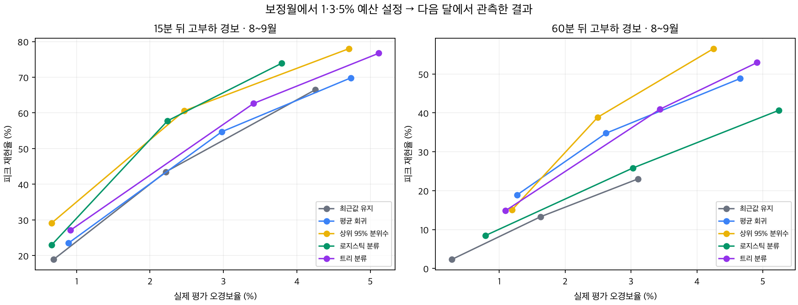

# ⑤ 전력 과제 후속 실험

원본 문제를 진단한 뒤, 평균 전력을 잘 맞추는 모델이 피크 경보에도 유리한지 검증한다. 주제 선정을 위해 이미 확인한 기간을 다시 쓴 **탐색적 시간순 평가**다. 새 외부 공장이나 미사용 블라인드 시험으로 표현하지 않는다.

## 실행

Python 환경에 `requirements.txt`를 설치한 뒤 아래 한 명령으로 직접 분류·평균/분위수 회귀·정책 비교를 실행한다. 데이터 파일은 코드에 포함하지 않는다.

```bash
python run_experiments.py --zip '/실제/경로/5. 자원 최적화 AI 데이터셋.zip'
```

현재 실행 환경과 라이브러리는 `interval_results/environment.json`에 기록했다. 모든 모델 설정·난수 시드는 코드에 고정돼 있다. 그래프는 macOS의 한글 글꼴을 사용하며 다른 운영체제에서는 글꼴을 별도로 지정할 수 있다. 수치 결과와는 무관하다.

## 검증 설계

- 입력은 예측 시점까지의 전력 및 미리 알 수 있는 달력 정보다. 정답을 포함하는 공장인원·동시점 평균·미래 실측 생산량·날씨는 사용하지 않는다.
- 오염된 시간 값이 있는 두 날짜를 제외하고 시간 공백을 유지한다. 필요한 과거 관측이 모두 있는 경우만 같은 평가 대상으로 사용한다.
- 5·6·7·8·9월 각각을 평가한다. 직전 월은 경보 기준 보정, 그 이전 자료는 모델 학습에 쓴다. 9월은 14일까지다.
- 모델 학습 정답과 보정 정답이 다음 단계의 첫 예측 원점보다 나중에 오지 않도록 15·60분 간격만큼 분할 경계를 띄운다.
- 고부하는 학습 전력의 95백분위 이상이다. 계약전력 초과나 실제 설비 위험 정답을 뜻하지 않는다.
- 보정월의 비고부하 구간에서 오경보가 1·3·5% 이내가 되도록 경보 문턱을 정한다. 같은 점수의 사례를 임의로 쪼개지 않는다. **다음 달 오경보율을 보장하는 제약은 아니다.**
- 60분 결과는 기본 실험에서는 ‘60분 뒤의 한 15분 구간 값’을 예측한다. 다음 1시간 전체의 최대값과 혼동하지 않는다. 별도 `window_*` 실험이 있으면 그 정의를 따른다.

## 결과 파일

| 파일 | 내용 |
|---|---|
| `classifier_report.md` | 로지스틱·트리 분류와 최근값 기준 비교 |
| `classifier_guide27_review.md` | 추가로 읽힌 원 가이드의 시간·단위·가공 변수 정의 |
| `classifier_predictions.csv.gz` | 모델별 시간·정답·위험 점수·경보 및 예측 원점 |
| [window_report.md](window_report.md) | 다음 60분의 네 구간 중 고부하 발생 여부, 겹치는 창·분할·새 패턴의 한계 |
| [window_experiment.py](window_experiment.py) | 다음 60분 경보 재현 코드; 위 일괄 실행 명령에 포함 |
| [window_results.json](window_results.json) · [월별 지표](window_monthly_metrics.csv) · [합산 지표](window_aggregate_metrics.csv) | 창 단위 정답, 월별 경보 예산 및 반복 패턴별 결과 |
| [window_predictions.csv.gz](window_predictions.csv.gz) | 예측 원점·창 종료·정답 최댓값·신규 진입·점수·경보 |
| [window_topic_review.md](window_topic_review.md) | 사출 원자료 복구 후 ⑤ 우선순위에 대한 독립 재검토 |
| [critique.md](critique.md) | 미래 정보 누수, 오경보 예산, 예측구간과 재표집 해석의 독립 검토 |
| `interval_results/` | 평균·분위수 회귀, 예측구간과 경보 문턱 평가 |
| `comparison/aggregate.csv` | 동일 시간점을 확인한 뒤 합친 성능표 |
| `comparison/failure_conditions.csv` | 시각·기존 고부하 여부 등에 따른 실패 조건 |
| `comparison/bootstrap.json` | 같은 날짜를 함께 재표집한 결과의 민감도 범위 |
| `comparison/verification.json` | 두 독립 구현의 정답·피크 기준·기준 경보 일치 확인 |
| `comparison/alarm_tradeoff.png` | 재현율과 실제 오경보율의 비교 |
| `comparison/monthly_false_alarms.png` | 월이 바뀔 때 오경보 예산이 유지되는지 확인 |



## 해석 제한

`new_peak_entry`는 예측 원점에서는 고부하가 아니지만 목표 구간은 고부하인 경우다. 서로 겹치는 예측 구간이 있으므로 독립적인 피크 사건 수나 설비 사고 수로 세지 않는다.

명목 90% 예측구간은 이 자료의 모든 달·피크 조건에서 90%를 포괄하지 않았다. 전체 포괄률이 좋아도 고부하 조건의 포괄률은 별도로 확인해야 한다. 시계열 의존과 분포 변화가 있으므로 확률적 보장을 주장하지 않는다.

일·7일 블록 재표집 범위는 현재 고정된 모델·문턱과 관측 기간의 표본 구성에 대한 민감도다. 모델 선택·재학습의 불확실성, 미래 달의 성능 보증을 포함하지 않는다. 합산 AP/AUC는 월별 재학습 점수를 합친 기술통계이므로 주 성과로 삼지 않고 월별 값을 참고한다.

분위수 회귀 구현은 [scikit-learn의 공식 예측구간 예제](https://scikit-learn.org/stable/auto_examples/ensemble/plot_gradient_boosting_quantile.html)와 [HistGradientBoostingRegressor 문서](https://scikit-learn.org/stable/modules/generated/sklearn.ensemble.HistGradientBoostingRegressor.html)를 확인했다. 기본적인 분위수 회귀와 이 자료에서의 실제 검증 결과는 구별한다.
