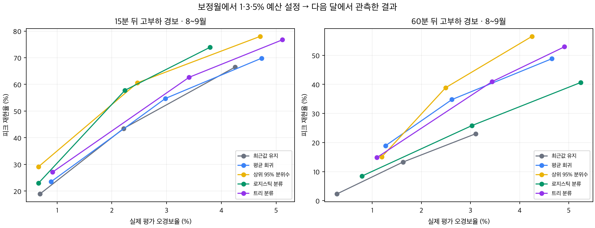

# 추가 자료와 후속 실험을 반영한 과제 재선정

검토일: 2026-09-22. **현재 추천은 ⑤ 전력사용량 예측·최대피크 위험조건 분석이다. 순위는 ⑤ > ④ > ① > ③ > ②로 갱신한다.** 사출 원자료가 열리면서 ①의 평가를 상향했다. 2~4위 사이의 확신은 낮으며, 현재 자료와 탐색 실험에서 가장 방어 가능한 수상 전략을 비교한 판단이다. 경쟁팀 수준을 알 수 없으므로 수상 확률을 숫자로 만들지 않았다.

이 문서는 첫 검토 이후의 최신 판단이다. 과거에 적었던 ‘사출의 날짜·좌우 부품 정보 부재’, ‘가이드 29종 확보’, ‘표시 제거 후 X-ray 검출 미실행’, ‘전력 피크 개선 미확인’은 아래 결과로 갱신된다. 이전 결과는 [1차 검토 기록](analysis/reselection/1차_과제재선정_검토기록.md)에 보존했다.

## 1. 실제로 어디까지 확인했는가

추가 가이드 49종 가운데 **46종의 본문을 확보**했다. 본문을 추출했다는 것과 모든 페이지를 같은 깊이로 육안 정독했다는 것은 다르다. 과제 선정에 중요한 수집 방법, 정답 정의, 생산 단위, 분할·평가 코드와 성능 주장을 중심으로 검토했다. 자료별 접근·검토 범위는 [최신 가이드 대장](analysis/followup_materials/guide_ledger.md)과 [1차 전체 자료 대장](analysis/reselection/자료별_검증대장.md)에 구분해 남겼다.

남은 본문 미확보는 ID 6 머신비전·23 장비이상 조기탐지의 읽기 대기, ID 12 X-ray 가이드의 현재 경로 미확인이다. 이것이 사용자가 말한 다운로드 실패 파일과 같다고 단정하지 않는다. 접근이 안 된 자료를 과제의 데이터 품질 문제로 감점하지 않았다.

핵심 대회 자료 ①·②·③·⑤는 ZIP 내부 파일과 표 전체를 읽었다. ④는 분석 대상 이미지·TXT를 모두 확보·검사했고, 대용량 모델 가중치는 저장하지 않았다. 추가 자료도 단순 파일명 확인에 그치지 않고, 읽힌 압축파일의 무결성·원표 전체·중복·라벨을 검사했다. **모든 추가 압축파일의 모든 내용을 완전히 검증했다고 주장하지 않는다.** 파일마다 성공·부분 복구·접근 대기를 별도로 기록했다. 보고서 양식은 검토하지 않았다.

## 2. 수상 가능성을 판단한 기준

[9월 22일 공식 수정 공고](https://www.kamp-ai.kr/contestNoticeDetail?CPT_NOTICE_SEQ=28)를 다시 확인했다. 서면평가는 데이터 이해·진단 15점, AI 예측모델 40점, 영향요인·오류분석 15점, 현장 활용 10점, 창의성·차별성 10점, 코드·재현성 10점이다. 외부 자료는 활용 사유·방법·출처를 밝히고 공개에 문제가 없는 자료를 사용해야 한다.

따라서 데이터 문제를 잘 찾는 것만으로는 충분하지 않다. **정당한 정답과 분할로 모델 개선을 입증하고, 실패 원인을 실제 검사·경보 판단에 연결할 수 있는가**를 가장 중요하게 보았다. 주제의 멋진 이름, 파일 용량, 가이드의 최고 정확도, 이미 투자한 시간은 순위의 근거로 삼지 않았다. 서로 다른 과제의 F1을 같은 척도처럼 비교하지도 않았다.

| 순위 | 과제 | 수상에 유리한 근거 | 아직 큰 제약 |
|---:|---|---|---|
| **1** | **⑤ 전력·피크** | 실제 미래 관측값으로 여러 달 평가 가능. 평균 예측뿐 아니라 피크 경보에서도 기준 대비 개선 확인. 월별 실패 분석과 운영 경보로 연결 가능 | 반복 패턴·가공 변수 누출을 통제해야 함. 9월 오경보 증가. 실제 절감 효과와 전력 단위 미확인 |
| **2** | **④ X-ray 이물** | 500개 고유 영상·24일·3대 검사기. 표시 제거 뒤에도 작은 이물을 검출할 신호가 남음. 미탐·재검사라는 설명 가능한 목표 | 처리 흔적을 이용할 위험. 정상 완제품 음성 자료 없음. 간단한 검출 실험까지이며 강한 모델의 독립 검증은 남음 |
| **3** | **① 사출 품질·검사** | 원자료로 시각·좌우 부품·원값·불량 사유 복원. 실제 불량을 여러 날짜에 걸쳐 검증 가능. 이전 정보 부족이 상당 부분 해소됨 | 실제 불량이 적고 특정 날짜에 집중. 미래 11월 성능이 약함. 미라벨 자료와 검사 자료의 생산 사건 중복 |
| **4** | **③ 프레스 펌프** | 행별 정상·고장 정의 확인. 정상만으로 학습·경보 보정 후 성능 비교 가능 | 정상 하루·고장 하루. 고장 발생 전 데이터와 독립 고장 사건이 부족해 ‘조기’ 탐지 주장을 검증하기 어려움 |
| **5** | **② 로봇 점용접** | 공정 조건·반복·불량 집계 구조를 설명할 수 있음 | 원 과제의 건별 품질 정답이 없음. 다른 용접 데이터가 그 정답을 채워 주지 못함 |

①을 ③보다 위로 올린 이유는 메타데이터가 복원되어 실제 제품 품질과 미래 날짜를 다룰 근거가 생겼기 때문이다. ③의 짧은 고장 기록과 발생 전 구간 부재는 현재 추가 자료로 해결되지 않았다. 다만 ①의 미래 성능까지 좋아진 것은 아니므로 두 과제의 차이를 크게 보지는 않는다. ④도 처리 흔적에 대한 대조 실험이 실패하면 아래로 내려야 한다.

## 3. ⑤ 전력: 후속 실험에서 피크 개선도 확인

### 원자료 해석과 검증

대회 원본은 257일·6,168행이며 한 행에 15·30·45·60분 값이 있다. 새로 읽힌 원 가이드 PDF 9·11쪽에서 각 열이 **0~15, 15~30, 30~45, 45~60분의 연속 구간**임을 확인했다. KAMP 추가 ZIP의 CSV와 대회 CSV는 바이트 단위로 같으므로 독립 외부 검증 자료 두 개가 아니다. kW·kWh 단위는 가이드에서도 명확히 확인되지 않아 임의로 붙이지 않았다. [원 가이드 검토](analysis/energy_followup/classifier_guide27_review.md)

다음 문제를 통제했다.

- `공장인원`은 전력 정답을 포함한 계산값과 일치하고, `평균`도 같은 행의 전력값에서 만들어진다. 미래 예측 입력에서 제외했다. 미래 실측 생산량·날씨도 쓰지 않았다.
- 하루 96개 전력값의 고유 패턴은 142개다. 반복 날짜를 구분하고, 처음 등장한 패턴의 결과를 별도로 확인했다.
- 시간 값이 손상된 7월 13·15일은 제외하되 시간 공백을 유지했다.
- 5~9월을 차례로 평가했다. 직전 월은 경보 문턱 보정, 그 이전은 학습에 사용했다. 학습·보정 정답이 다음 단계의 첫 예측 시점보다 미래가 되지 않도록 경계를 띄웠다.
- 과거 전력과 달력만 사용했다. 고부하 정답은 학습 전력의 95백분위 이상이며, 실제 계약전력 초과 정답은 아니다.

8월 1일~9월 14일의 45일은 앞선 학습 날짜와 동일한 하루 패턴이 없었다. 이 기간의 완전 일치 연속 구간도 따로 점검했다. 그렇다고 모든 합성·변형 가능성이 배제된 독립 공장 자료라는 뜻은 아니다.

### 15분 뒤 한 구간의 고부하

같은 4,320개 시점, 고부하 391개를 비교했다. 경보 문턱은 **보정월의 비고부하 구간에서 오경보 5% 이내**라는 동일 규칙으로 정했다. 다음 달의 실제 오경보율까지 같거나 5% 이내라는 뜻은 아니다.

| 모델 | 고부하 재현율 | 실제 시험 오경보율 | F1 | 발견한 고부하 / 놓친 고부하 |
|---|---:|---:|---:|---:|
| 최근 전력값 기준 | 66.5% | 4.25% | 0.636 | 260 / 131 |
| 로지스틱 분류 | **73.9%** | **3.79%** | **0.697** | **289 / 102** |
| 상위 분위수 회귀 | 78.0% | 4.71% | 0.692 | 305 / 86 |

로지스틱은 이 기간의 관측 결과에서 놓친 고부하를 29개 줄이면서 오경보도 167개에서 149개로 줄였다. 상위 분위수 회귀는 더 많이 찾지만 오경보가 185개로 늘어난다. 단순 평균 오차 개선만 있었던 1차 검토보다, 경보 과제로 개발할 근거가 강해졌다.

이 표는 후속 실험의 학습·보정 설계로 다시 계산한 것이다. 1차 보고서의 다른 학습 범위·고정 경보 기준으로 계산한 F1과 직접 증감 비교하지 않는다.

### 다음 한 시간 안의 고부하

‘60분 뒤 한 구간’과 별도로, **앞으로 15·30·45·60분 구간 중 하나라도 고부하가 되는지**를 예측했다. 같은 기간 4,320개 예측창 가운데 고부하 창은 722개다. 아래는 보정월 오경보 예산 3%로 정한 정책이다.

| 모델 | 고부하 창 재현율 | 실제 시험 오경보율 | F1 |
|---|---:|---:|---:|
| 최근 전력값 기준 | 48.3% | 2.39% | 0.603 |
| 로지스틱 분류 | 54.2% | 3.36% | 0.634 |
| HGB 트리 분류 | **71.7%** | **3.34%** | **0.762** |

HGB는 고부하 창을 349개에서 518개로 더 많이 찾는 대신 오경보가 86개에서 120개로 늘었다. 예측 당시에는 고부하가 아니었던 신규 진입 창 401개 중에서는 최근값이 28개, HGB가 246개를 포착했다. 이미 높은 전력을 그대로 연장하는 것 이상의 신호가 있다는 근거다.

예측창은 15분마다 만들며 서로 45분을 공유한다. 따라서 722개나 401개를 독립적인 물리적 피크 사건 수로 세지 않는다. 자세한 정의·월별 결과는 [다음 한 시간 경보 실험](analysis/energy_followup/window_report.md)에 있다.

### 남은 실패가 수상용 개발의 핵심

좋은 합산값만 보여서는 부족하다. 9월에는 15분 로지스틱의 실제 오경보율이 6.78%였다. 다음 한 시간 HGB도 보정 예산 3%에서 실제 7.00%, 보정 예산 5%에서 실제 9.78%로 상승했다. 명목 90% 예측구간 역시 모든 달과 고부하 조건에서 90%를 포괄하지 못했다. 예를 들어 8월의 15분 고부하 조건 포괄률은 약 59%였다.

따라서 추천 개발 주제는 **“운전 패턴 변화에 대응하는 공장 전력 예측과 다음 한 시간의 고부하 경보”**다. 단순 모델의 성능을 넘기는 것에 더해, 오경보가 늘어나는 조건·경보 문턱 갱신·반복 알림 억제·놓친 피크를 함께 평가하는 방향이 좋다. 생산일정 조정은 제어 가능한 부하와 납기 제약을 가정한 시뮬레이션으로 범위를 명시해야 한다. 현재 데이터만으로 실제 전기요금 절감이나 최적 운전의 인과 효과가 검증된 것은 아니다.

이번 기간은 주제 선정 과정에서 이미 봤다. 따라서 이 결과는 **탐색적 시간순 검증**이며 미사용 최종 시험이 아니다. 날짜 재표집 민감도와 독립 코드 교차검토도 수행했지만, 이를 미래 성능 보장으로 해석하지 않았다. [실행 방법·전체 결과](analysis/energy_followup/README.md), [독립 검토](analysis/energy_followup/critique.md)

## 4. ① 사출: 이전 판단에서 반드시 고칠 부분

이번에 읽힌 KAMP 원 ZIP에는 8개 CSV가 있다. 이 중 대회에서 받은 4개 CSV와 동명 원본은 **전부 바이트 단위로 동일**하다. 남아 있던 인덱스로 대회 전 행의 생산 시각·정확한 부품명·좌우 구분·센서 원값을 복원했고, 표준화값을 다시 계산한 최대 오차는 약 1.7×10⁻¹³ 이하였다.

**동일 센서값에 다른 라벨이 붙은 36쌍은 전부 같은 시각의 좌·우 부품이었다.** 예를 들어 한쪽 부품은 가스 불량, 다른 쪽은 양품이다. 부품 정보를 포함하면 해당 충돌은 사라진다. 따라서 이를 근거로 ‘사출 자체가 입력 모순 때문에 불가능하다’고 판단하면 잘못이다. 센서만 제공된 상태의 한계와, 원자료로 정보를 복원한 상태를 구별해야 한다.

가이드 일부 표는 라벨 방향이 뒤집혀 있었지만, 원표의 Y/N·불량 사유와 대회 행을 전수 대응해 **0=양품, 1=불량**을 확인했다. 원표 7,996행 중 완전 복제 2,764행을 제거하면 5,232행·불량 60행이다. 불량은 6개 날짜·52개 생산시각·한 설비에 한정된다. 불량 사유는 가스·미성형·초기허용불량이다. 60개가 모두 독립적인 제조 사건이나 같은 종류의 출하 불량인 것은 아니다. 초기허용불량은 따로 확인해야 한다.

새로 가능해진 날짜 순 검증도 실제 실행했다. 실측 단위 센서를 사용하고 검사 결과·불량 사유·제품 ID를 입력에서 제외했다.

- 대회 기간인 10월 23일까지 2,393행·불량 42개로 학습하고, 그 이후 CN7·RG3 2,837행·불량 18개를 평가했다. 센서 RF는 일별 상위 10% 검사에서 8/18개를 찾았다. 다만 평가 불량에는 초기허용불량 10개가 포함돼 있다.
- 10월 전체로 학습하고 11월 1,000행·불량 8개를 평가하면, 고정한 6개 모델은 일별 상위 10% 검사에서 **0~1개만 발견**했다. 좌우 부품을 넣는 것만으로 미래 검출이 해결되지 않았다.
- 라벨·미라벨 자료에는 동일 설비·시각·부품의 생산 사례 1,984개가 겹친다. 두 파일의 센서 소수점 차이가 작다고 서로 독립인 자료로 분할하면 안 된다.

전체 예측 순위에는 신호가 있다. 예를 들어 11월의 센서 HGB AP는 0.153으로 불량 비율 0.008보다 높았다. 따라서 ‘사출은 예측 신호가 없다’고 해석하면 과하다. 다만 하루 단위 검사 예산에서 성과가 약했고, 불량 8개 중 7개가 한 날짜의 RG3에 집중됐다. 전체 순위의 성과와 제한된 일별 검사 효율을 구별해야 한다.

사출의 장점은 실제 검사 목적과 여러 날짜의 원자료를 확보했다는 점이다. 현재 약점은 정보 복구 이후에도 미래 불량의 검사 효율 개선이 약하고, 불량이 적은 날짜에 집중된다는 점이다. **분석 가능성과 검증 가능성은 상향, 재현 가능한 검사 효율 개선은 아직 미입증**으로 판단했다. 복원 근거와 예측 결과는 [사출 복구 보고서](analysis/followup_materials/injection_recovered/injection_recovered_verdict.md)에 있다.

## 5. ④ X-ray: 표시를 지워도 검출 신호는 남지만 검증 범위는 제한됨

공식 TXT와 대응하는 서로 다른 영상 500개·이물 상자 1,147개를 확인했다. 색상 표시를 직접 특징으로 쓰면 안 되고, 표시 제거·마스킹·인페인팅을 사용할 때 영향을 설명해야 한다는 [수정 공고](https://www.kamp-ai.kr/contestNoticeDetail?CPT_NOTICE_SEQ=28)를 적용했다.

정답 상자를 보지 않고 영상의 색상 픽셀만 찾아 마스크를 만들고, 주변 회색값으로 채우는 처리를 실행했다. 1픽셀 확장 마스크는 정답 상자 407/1,147개와 겹쳤고, 상자별 겹친 면적의 평균은 5.24%, 최대는 47.1%였다. 2픽셀 확장은 평균 16.1%로 상자와 겹치는 범위가 커졌다. 이는 상자 면적 기준이며 실제 이물이 손상된 비율과는 다르다. **정답을 쓰지 않은 처리와 이물 신호를 손상하지 않은 처리는 같은 뜻이 아니다.**

간단한 LoG 기반 검출기도 실행했다. 앞선 16일 380장, 중간 3일 41장, 마지막 5일 79장으로 날짜를 나눴고 완전히 같은 영상이 분할 사이에 겹치지 않았다. 마지막 79장의 정답 79개에서 IoU≥0.5 기준 정밀도 43.5%, 재현율 88.6%, F1 0.583, 영상당 거짓 검출 약 1.15개였다. 중간 검증 구간의 F1은 0.315로 낮아 날짜별 안정성까지 확보된 것은 아니다.

이는 표시를 지운 뒤에도 검출할 만한 신호가 있다는 탐색 근거다. 정상 완제품 오경보율, 깨끗한 원본 복구, 인페인팅 흔적에 무관한 검출, 학습형 검출기의 최종 성능을 입증한 결과는 아니다. 마지막 평가 영상은 모두 이물 정답이 있는 양성 영상이고 영상당 정답 수 분포도 앞선 날짜와 다르다. 표시 제거 방식 변경·정상 배경 대조·검사기별 성능 검증이 성공해야 2위 추천을 더 강하게 할 수 있다. [X-ray 후속 보고서](analysis/xray_followup/xray_followup_report.md), [정량 결과](analysis/xray_followup/cleaning_probe_results.json), [처리 비교 예시](analysis/xray_followup/comparison_250.png)

## 6. ③ 프레스와 ② 용접: 추가 자료가 채우지 못한 핵심

③의 원 가이드 PDF 11~12쪽에서 정상 0·고장 1이라는 정의와 7월 12·17일의 수집 설명을 확인했다. KAMP 원 CSV는 대회 CSV와 완전히 같았다. 정상 20,000행·이상 600행은 실제로 정상 하루·고장 하루의 짧은 기록이며 별도 고장 사례가 추가된 것이 아니다.

정상만으로 학습·문턱을 보정한 1차 실험에서 5개 최근접 이웃 거리 모델은 F1 0.602, 정상 평가 오경보 약 0.22%였다. 이는 유효한 상태 탐지 출발점이다. 그러나 가이드의 ‘100행 뒤 예측’을 고장 10초 전 조기경보라고 그대로 부를 수는 없다. 기록 공백으로 실제 시간차가 다르고, 입력 창 자체가 이미 고장 상태인 경우다. 고장 발생 시점과 발생 전 구간을 알 수 없어 핵심 요구의 ‘조기’ 부분이 좁다.

②의 대회 점용접 자료는 여전히 Raw 11,939행, 센서 네 개의 고유 조합 1,574개, result 23행의 날짜·유형별 집계다. `defect` 합 39를 개별 용접 행과 연결할 수 없다. 이 집계가 고유 불량 제품 39개라는 뜻인지도 확정되지 않는다. 추가 파이프·배터리 용접 자료가 많아져도 원 점용접의 건별 정답을 만들어 주지는 않는다.

②를 유지하려면 원 과제에서 검증 가능한 불량 정답 또는 충분한 독립 집계 자료가 필요하다. 이상 점수를 스스로 정답으로 바꾼 뒤 높은 F1을 보고하는 방식은 모델 성능의 증거가 아니다. **수상 가능성만 기준으로 보면 기존 용접 선택을 유지할 근거가 가장 약하다.** [프레스·추가 용접 검토](analysis/followup_materials/maintenance_and_welding_followup.md)

## 7. 확보한 추가 자료가 실제로 바꾼 것

| 추가 자료 | 새로 확인한 사실 | 수상 전략에 미친 영향 |
|---|---|---|
| ID 4 사출성형기 | 대회 파일과 정확히 연결되는 시각·좌우 부품·원 센서값·추가 날짜 정답 확보 | ①의 정보 부족 근거를 수정하고 순위 상향 |
| ID 27 자원 최적화 | 15분 구간 해석 확인, 대회 CSV와 동일, 가이드에도 시간 손상·가공 변수 문제가 있음 | ⑤의 예측 시점을 명확히 정의. 독립 외부 데이터로 중복 계산하지 않음 |
| ID 48 소성가공 예지 | 정상·고장 정의 확인. 대회 CSV와 동일. 고장 입력 뒤의 고장 라벨 예측 | ③의 상태 의미는 명확해졌으나 실제 조기경보 증거는 추가되지 않음 |
| ID 50 정밀가공 품질 | 불량 99행 전부 동일 제품번호·시각의 양품이 있고, 센서값이 두 종류의 고정 배수 변형으로 정확히 대응 | 높은 날짜 분할 F1도 독립 실물 불량 검증으로 해석하지 않음. 생성 의도는 미확인 |
| ID 51 용접 예지 | 정상·불량의 다섯 센서 범위가 각각 모두 분리됨 | 100% 분류가 어려운 현장 고장 예측의 증거라는 해석 배제 |
| ID 52 용접 공정최적화 | 739,888행은 303개 파이프. 같은 나무 모델의 불량 F1이 행 무작위 .721에서 파이프 독립 .456으로 하락 | 행 수·양품 F1을 실제 불량 검증 근거로 과대평가하지 않음 |
| ID 2 Ford 엔진 | TRAIN.txt 일부는 NUL로 읽을 수 없지만 같은 ZIP의 ARFF 3,601개 학습·1,320개 시험 사례는 정상 | 전체 데이터가 사용할 수 없다고 버리지 않음. 파형 방법 비교는 가능하나 프레스 고장시점 대체 불가 |
| ID 9 교반 | 351,232행 정답이 `abs(Sensor)>2` 규칙과 전수 일치 | 규칙 복원과 실제 고장 일반화를 구별 |
| ID 11 건조 | 가이드가 인위적으로 만든 고장임을 명시 | 인위 고장 실험으로 범위를 밝힐 때 사용 |
| ID 18 회전기계 | 볼트·지지 상태를 조작한 물리 실험, 상태당 140초 | 센서 위치·고장 유형 비교에는 가치. 다수의 독립 현장 고장으로 계산하지 않음 |
| ID 43 열처리 예지 | 센서 IQR 초과 개수로 만든 이상 라벨 | 실제 고장 정답을 추가 확보한 것으로 보지 않음 |
| ID 53 주조 | 73,612행과 미래 구간 기준 실험 확인 | 품질 검사 방법의 다른 공정 검증 후보. 사출 성능과 구별 |
| ID 56 사출 예지 | 가이드 라벨은 분석자가 구성. 원 ZIP 일부만 복구 | 실제 품질 정답을 크게 확장하는 자료로 해석하지 않음 |
| ID 59 기계부품 | 가이드의 STATUS 정의는 가정이며 실제 전문가 라벨 필요 명시 | 동시 알람 코드 검출을 실제 정비 사건 예측으로 바꾸지 않음 |
| ID 60·61 열처리 | 품질표 공통 7열 136행이 동일 | 독립 외부 검증 두 개로 중복 계산하지 않음 |
| ID 62·90 의류 | 품질 34,156행은 125개 Lot 반복, 가이드 시험 Lot이 학습에 등장 | 제품/Lot 단위 검증이 필요. 행 수에 따른 과대평가 배제 |

그 밖의 추가 자료는 기존 분야별 검토와 최신 대장에 연결했다. 자료가 어떤 문제를 갖고 있다는 사실이 곧 쓸모없다는 뜻은 아니다. **방법을 연습·비교하는 자료인지, 실제 원 과제의 정답과 독립 검증을 보강하는 자료인지**를 구별하는 것이 핵심이다.

## 8. 다음 개발에서 고정할 방향

현재 근거로는 ⑤를 중심으로 개발을 이어가는 것이 가장 합리적이다. 평균 전력 예측과 다음 한 시간 고부하 경보를 함께 다루되, 9월 같은 분포 변화에서 오경보가 늘어나는 문제를 주요 개선 목표로 삼는다. 검증 기간을 반복 선택해 유리한 결과만 제시하지 않도록 모델·문턱 선택과 바깥 날짜 평가를 구분한다. 반복 경보를 묶은 운영 알림과 놓친 고부하를 함께 평가하고, 일정 이동 효과는 명시한 가정 안에서만 계산한다.

①은 복원한 원자료를 보존하고 대안으로 유지한다. ④는 표시 처리 흔적에 대한 대조 실험이 다음 판단의 핵심이다. ③·②는 모델 복잡도를 높이기 전에 현재 자료가 실제 조기 고장·건별 불량 정답을 제공하는지라는 한계를 계속 구분해야 한다.

실험 코드·예측값·분할·검증 결과는 로컬 `analysis/`에 저장했다. 원본 자료는 변경하지 않았다. GitHub에는 이 후속 산출물이나 데이터셋을 업로드하지 않았다.
