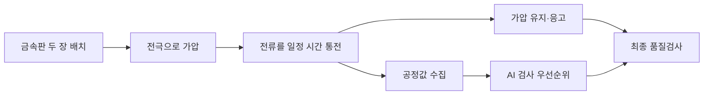
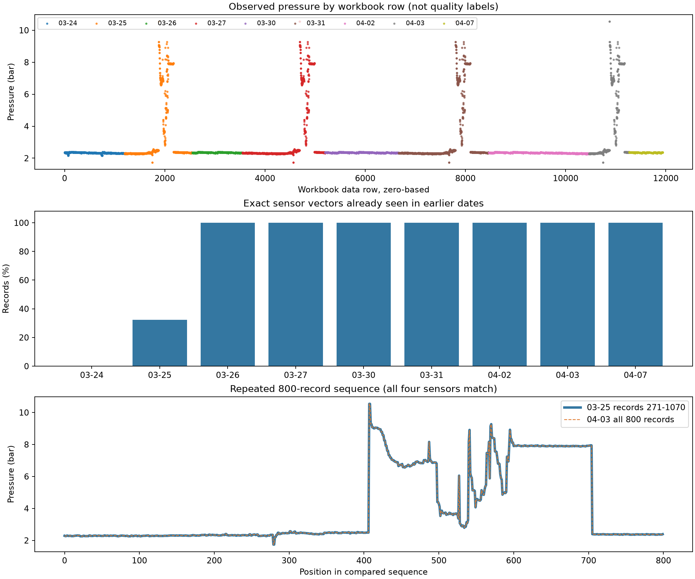

# ② 로봇용접 심층분석과 연구 설계

작성일: 2026-09-22. 팀의 확정 주제인 ②를 기준으로 수상 경쟁력을 높일 연구를 설계한다. 과제공개 문서, 용접 XLSX의 모든 시트·셀 메타데이터, CSV 전 행을 확인했다. 보고서 양식은 열지 않았다. 아래에서는 **확인된 사실, 해석 가설, 앞으로 검증할 제안**을 구별한다.

## 1. 현재 권하는 방향

**“용접 조건의 상호작용과 데이터 신뢰도를 고려한 검사 우선순위·공정조건 지원”**을 연구의 중심으로 잡는다.

핵심 질문은 다음과 같다.

> 같은 검사량에서 단순 센서 임계값보다 실제 불량을 더 많이 포착하고, 판단 근거가 부족한 조건을 구분할 수 있는가?

지금 구현할 기반은 네 센서의 공정이탈 점수, 검사대상 후보, 낯선 조건·모델 불일치 표시다. 최종검사 정답이 연결되면 실제 불량 포착률과 오류 조건을 검증한다. 집계 정답만 확인된다면 일별 집계 분석을 추가하되, 개별 불량 검증과 구분한다.

공식 공공데이터 목록에서도 2020년 **용접기 AI 데이터셋은 소재두께·가압력·전류·전압·통전시간과 이상치 탐지 알고리즘을 활용하는 품질보증 자료**로 소개된다. 따라서 이상탐지를 출발점으로 삼는 데는 근거가 있다. 다만 그 소개가 이번 대회의 F1·미탐·오경보 평가 방법까지 정해 주지는 않는다. [중소기업기술정보진흥원 공개 목록 CSV](https://www.data.go.kr/cmm/cmm/fileDownload.do?atchFileId=FILE_000000003536160&fileDetailSn=1&insertDataPrcus=N), [목록 설명 페이지](https://www.data.go.kr/data/15089213/fileData.do)

현재 가장 큰 해결 과제는 **공정값과 실제 품질검사 정답의 연결**이다. 복잡한 모델보다 이 연결과 검증 단위를 먼저 확정하는 것이 수상 경쟁력에 더 직접적이다. 데이터 진단이나 화면 완성도만으로 모델·오류분석 배점의 부족이 자동으로 해결되지는 않는다.

## 2. 어떤 용접 공정인가

### 두 금속판을 누르고, 전류로 접합한다

파일의 `Spot-01`, 두 장의 0.7 mm 소재, 가압·전류·전압·통전시간 구성은 **저항점용접**에 부합한다. 겹친 금속판을 전극으로 누른 뒤 짧게 큰 전류를 흘리면 저항에 의해 접합부가 가열된다. 녹았다가 굳은 작은 접합부를 너깃(nugget)이라 부른다. 로봇은 용접 건을 필요한 위치로 움직이는 자동화 수단이다. [TWI 공정 설명](https://www.twi-global.com/technical-knowledge/faqs/what-is-spot-welding)

그림은 일반 공정과 제안 시스템의 관계다. 파일이 각 단계에서 정확히 언제 값을 저장하는지는 확인이 필요하다. 특히 전체 통전시간 등 한 회의 요약값을 사용한다면 예측 시점은 **해당 용접 공정값을 얻은 뒤, 최종 품질검사 이전**이다. 용접 시작 전 예측이나 통전 중 실시간 제어를 이미 구현했다고 표현하면 안 된다.

### 전류 하나로 품질이 결정되지 않는 이유

저항 발열을 단순화하면 `Q ≈ I²Rt`다. 하지만 접촉저항 R은 가압·표면·온도 등에 따라 변하고, 열 일부는 전극과 주변으로 빠져나간다. 같은 전류라도 가압과 통전시간이 다르면 결과가 달라질 수 있다. 통전 전 접촉을 안정시키는 시간과 통전 후 가압을 유지하는 시간도 중요하다. 현재 파일에는 이런 전체 과정의 파형과 단계별 정보가 없다. [AMADA WELD TECH 원리 자료](https://amadaweldtech.com/wp-content/uploads/2023/04/Resistance-Welding-Fundamentals.pdf)

따라서 조사할 것은 전류×가압, 전류×시간, 전류와 전압의 관계다. 이는 **분석할 물리적 가설**이며 현재 데이터에서 입증한 불량 원인은 아니다.

### 파일에 등장하는 세 가지 불량

| 기록된 명칭 | 초심자 관점의 의미 | 아직 없는 정보 |
|---|---|---|
| 파임불량 | 전극 접촉 부위가 허용 수준보다 깊게 눌리거나 손상된 상태로 해석 | 허용 깊이, 사진, 전극 상태, 검사 기준 |
| 용접부족 | 두 판이 요구 수준으로 충분히 접합되지 않은 상태로 해석 | 접합부 크기·강도 기준, 파괴/비파괴 검사 결과 |
| 크랙발생 | 접합부 또는 주변의 균열 | 내부/표면 여부, 위치, 소재·코팅, 발생 시점 |

정상 용접에도 표면 눌림이 생길 수 있다. 자국만으로 불량을 확정할 수 없고 전극 정렬·접촉면·냉각도 관여한다. 따라서 파임을 “가압력 높은 행”으로 자동 라벨링하는 것은 근거가 부족하다. [TWI 표면 자국 설명](https://www.twi-global.com/technical-knowledge/faqs/faq-how-can-i-minimise-the-surface-marking-on-resistance-spot-welded-joints)

## 3. 실제 데이터는 무엇을 담고 있는가

| 파일·시트 | 규모 | 역할 |
|---|---:|---|
| XLSX `Raw data` | 11,939행 × 10열 | 공정 측정/설정값과 날짜·생산순번·설비·품목·두께 |
| XLSX `result` | 23행 × 7열 | 8개 날짜의 결함유형별 결과로 보이는 기록 |
| XLSX `data set` | 10행 × 3열 | Raw 열의 설명과 수집 범위 |
| `scaled_data.csv` | 11,939행 × 5열 | 저장 인덱스와 가공된 센서 4개 |

Raw에는 결측이 없다. 설비는 Spot-01 하나, 품목은 하나이며 두께는 두 열 모두 0.7 mm로 일정하다. 품목 코드만으로 실제 제품 종류를 확정할 수 없다. 실질적으로 변화하는 공정 입력은 다음 네 개다.

| 열 | 기록 단위 | 실제 최소~최대 | 해석 주의점 |
|---|---|---:|---|
| `weld force(bar)` | bar | 1.74~10.54 | bar는 압력 단위다. 전극에 작용하는 힘 N/kN으로 바로 바꿀 수 없음 |
| `weld current(kA)` | kA | 14.52~15.07 | 설정값/실측값, 평균/RMS/피크인지 미확인 |
| `weld Voltage(v)` | V | 2.464~2.861 | 측정 위치와 전류와의 집계 시간 일치 여부 미확인 |
| `weld time(ms)` | ms | 70~73 | 로봇 전체 작업시간과 구별. 72.16 등 소수 원값도 존재 |

`working time`은 2020-03-24~04-07 사이 9개 날짜다. 엑셀 표시서식에는 시간이 포함되지만 실제 저장값은 모두 00:00이므로 작업 시각은 없다. `idx`는 생산순번이라고 설명되어 있지만 한 행이 제품 한 개인지, 용접점 한 개인지, 한 번의 통전인지까지 명시되어 있지 않다.

과제 배경에 등장하는 용접속도는 제공 열에 없다. 용접 내부 고속 파형, 전극 마모·교체, 소재강종, 표면 상태, 실제 접합강도, 로봇 좌표도 없다. 이런 정보가 있는 것처럼 시계열 모델이나 제어 모델을 구성하지 않는다.

## 4. 품질 결과와 원시 기록을 연결할 수 있는가

### 현재 확인된 결과표

아래 값은 `defect`를 건수로 읽는 **잠정 해석**이다. 정확한 정의와 검사 모집단은 주최 측 확인이 필요하다.

| 날짜 | Raw 행 수 | 파임 type1 | 용접부족 type2 | 크랙 type3 | 기록값 합계 |
|---|---:|---:|---:|---:|---:|
| 03-24 | 1,200 | 2 | 1 | 1 | 4 |
| 03-25 | 1,352 | 3 | 2 | 3 | 8 |
| 03-26 | 1,000 | 3 | 2 | 2 | 7 |
| 03-27 | 1,648 | 미기록 | 미기록 | 미기록 | 미기록 |
| 03-30 | 1,470 | 1 | 2 | 1 | 4 |
| 03-31 | 1,800 | 2 | 3 | 미기록 | 5, 부분합 |
| 04-02 | 2,000 | 1 | 1 | 2 | 4 |
| 04-03 | 800 | 2 | 1 | 1 | 4 |
| 04-07 | 669 | 0 | 1 | 2 | 3 |
| 합계 | 11,939 | 14 | 13 | 12 | 39 |

**39는 기록된 결함유형 값의 합이다.** 같은 제품의 복수 결함 중복 여부를 모르므로 불량품 39개라고 확정할 수 없다. 검사 대상 수와 Raw의 행 수가 같은지도 몰라서 전체 불량률로 바로 나눌 수 없다. 미기록과 명시된 0도 구별한다.

### idx를 붙이면 정답이 생기는가

Raw idx는 날짜별 생산순번이고, result idx는 결과 23행을 나열한 1~23이다. 이름이 같다는 이유로 조인해 정상/불량 정답을 만드는 것은 타당하지 않다. 날짜까지 함께 조인해 일부 대응을 만들더라도 그 번호가 같은 생산 단위를 뜻한다는 근거가 없다.

숨김 시트·숨김 행/열·수식·메모·서식 등도 확인했지만 별도 품질 정답은 발견되지 않았다. 데이터 사전은 Raw 10열만 설명하고 result의 `defect`와 `idx`를 정의하지 않는다.

### 일별 건수를 맞히는 것과 불량 제품을 찾는 것은 다르다

예를 들어 하루 1,000개 중 불량이 5개이고 모델도 5개에 경보를 냈다고 하자. 두 집합이 일치할 수도, 전혀 겹치지 않을 수도 있다. 경보 개수만 맞으면 실제로 잡은 불량 수는 0~5개 모두 가능하다.

일별 정답 비율로 학습하는 LLP(Learning from Label Proportions) 자체는 연구 근거가 있다. 하지만 먼저 집계 정의와 분모가 확인되어야 하며, 8개 날짜의 합을 맞혔다고 개별 용접의 불량 확률·F1이 검증되지는 않는다. [Tsai & Lin, 2020](https://proceedings.mlr.press/v129/tsai20a.html)

## 5. 정밀 감사에서 새로 확인한 중요한 특징

### 5-1. 날짜가 달라도 같은 긴 센서 기록이 반복된다

- 전체 센서 4개 조합은 **1,574종**이다. 총 11,939행 중 10,365행은 앞서 나온 조합과 같다.
- **3/26 이후의 9,387행 전부가 3/24~25에 이미 등장한 센서 조합**이다. 원값을 정확하게 비교한 결과이며 반올림 때문이 아니다.
- 4/3의 **800행 전체**가 3/25의 일부 800행과 네 센서 모두 같은 순서로 일치한다. 3/27·3/31에도 같은 구간이 있다.
- 가압력이 5bar를 넘는 기록은 3/25·3/27·3/31·4/3에 각각 243행이고, 네 날짜의 해당 센서 시퀀스도 완전히 같다. 5bar는 패턴을 설명하기 위한 구분값이며 불량 기준이 아니다.

같은 설정을 반복하면 같은 값이 나올 수 있지만, 이런 긴 다변량 시퀀스의 반복은 수집·복제·가공 이력을 확인해야 할 근거다. 현재 파일만으로 생성 방식을 확정하지 않는다.

**검증에 미치는 영향:** 무작위 행 분할뿐 아니라 단순 날짜 분할도 새로운 패턴에 대한 독립 검증을 보장하지 못한다. 첫 이틀을 학습에 쓰고 이후 날짜에서 같은 센서 조합을 모두 제외하면 새 조합 테스트는 0행이다. 이를 감추고 다른 분할의 점수를 미래 성능으로 제시해서는 안 된다.

동일 조합을 같은 그룹으로 묶는 분할은 보조 분석으로 사용할 수 있다. 다만 새로운 센서 조합에 대한 평가이지 새로운 공장의 미래 품질을 검증한 것은 아니다. 또 중복 행을 지운 후 원래 날짜의 불량건수를 그대로 연결하면 집계의 모집단이 달라질 수 있다.

### 5-2. 날짜가 잘못 적혔을 가능성이 있는 두 셀

`Raw data!D3552`, `Raw data!D5201`은 3/27 생산순번 구간의 처음과 끝인데 날짜가 3/25로 저장되어 있다. 두 셀을 3/27로 보면 3/25는 idx 1~1350, 3/27은 idx 1~1650으로 자연스럽게 이어진다.

이는 합리적인 **정정 가설**이다. 원본은 수정하지 않았으며 현재 분석은 원래 날짜를 보존한다. 같은 `(날짜, idx)`를 가진 서로 다른 센서 기록도 있어 이 두 열만으로 고유 키를 만들지 않는다. 파일명·시트명·엑셀 행 번호를 추적용으로 보관한다.

### 5-3. scaled CSV의 가공 관계를 상당 부분 복원했다

CSV를 원단위 후보로 역변환하고, XLSX의 표시 자릿수에 맞춰 비교했다. 전압은 원값 소수 3자리와 달리 화면에 2자리, 통전시간은 정수로 표시되는 점이 중요했다.

| CSV 열 | 역변환 후보 | 결측 셀 | 복원 후 기재 수집범위 밖 셀 |
|---|---|---:|---:|
| 가압력 | `x × 118.26 + 1.74` | 18 | 43 |
| 전류 | `x × 139.78 + 14.52` | 15 | 50 |
| 전압 | `x × 95.78 + 2.46` | 15 | 27 |
| 통전시간 | `x × 2170 + 70` | 23 | 47 |
| 합계 | | 71 | 167 |

공식 scaler가 없어 위 식은 **대응 검증을 거친 후보식**이다. 결측·수집범위 초과 238셀의 영향을 받는 행은 237개이고, 나머지 **11,702행은 Raw 표시 정밀도로 반올림한 센서 조합과 중복 수량까지 맞춰 모두 대응된다.** CSV를 별개의 독립 관측 데이터로 보기는 어렵다. 행 순서가 그대로 맞지 않고 같은 조합이 반복돼 개별 행의 정체성을 유일하게 복원한 것은 아니다.

이 결과는 반올림·정규화·일부 값 변경이 이루어졌다는 설명과 맞지만 교육용 오류 주입 여부를 확정하지 않는다. 이전 임시 감사에서 사용한 전압 역산 후보 `x×9.578+2.676`은 폐기하며, 위 새 후보를 사용한다.

분석의 기준 데이터는 **XLSX Raw**로 삼는다. CSV는 결측·범위 이탈 입력 처리의 보조 실험에 활용할 수 있지만, CSV의 극단값을 실제 용접불량 정답으로 삼지 않는다.

## 6. 실제 실행한 첫 모델 실험

### 실험 목적과 조건

공정이탈 점수를 산출할 수 있는지, 모델별로 어떤 기록을 고르는지 확인하는 **무라벨 동작 시연**이다. 품질예측 정확도나 독립 미래 성능을 평가하는 실험이 아니다.

- 기준자료: 3/24~25의 2,552행. 정상으로 확인된 데이터라는 뜻이 아니다.
- 점수 산출 대상: 이후 9,387행. 모든 센서 조합이 기준자료에 이미 존재한다.
- 입력: 원시 센서 4개. 날짜·idx·설비·품목은 모델 입력에서 제외.
- 임계값: 각 모델이 기준자료에 부여한 점수의 99분위수. 실제 오경보율 1%나 실제 불량률 1%를 의미하지 않는다.
- 성능 튜닝이나 실제 불량 F1 산출은 하지 않았다.

| 모델 | 점수의 의미 | 실행 설정 |
|---|---|---|
| 중앙값·MAD 기준선 | 각 센서가 대표값에서 얼마나 벗어났는지의 최대값 | MAD 0이면 표준편차로 대체 |
| Isolation Forest | 무작위 분할에서 상대적으로 고립되기 쉬운 기록 | 300개 트리, max_samples=256, seed=7 |
| One-Class SVM | 센서 조합의 분포 경계와 관련된 점수 | RobustScaler, RBF, gamma=scale, nu=0.01 |

SVM의 nu는 모델 설정값이며 불량률 추정치가 아니다. `score_samples`의 방향을 뒤집어 값이 클수록 이탈 점수가 높게 맞췄다. 확률로 변환하지 않았다.

### 경보 개수는 비슷해도 같은 대상을 고르지 않는다

| 날짜 | 통계 기준선 | Isolation Forest | One-Class SVM |
|---|---:|---:|---:|
| 03-26 | 0 | 0 | 0 |
| 03-27 | 26 | 26 | 24 |
| 03-30 | 0 | 0 | 0 |
| 03-31 | 26 | 26 | 24 |
| 04-02 | 0 | 0 | 0 |
| 04-03 | 26 | 26 | 24 |
| 04-07 | 0 | 0 | 0 |

표는 **기준 점수를 초과한 행 수**이며 실제 불량 검출 수가 아니다. 4/3의 800행에서 통계 기준선과 Isolation Forest가 함께 고른 행은 17개, 세 모델이 모두 고른 행은 5개다. 세 날짜에서 수량이 같은 점도 반복 시퀀스와 연결해 읽어야 한다.

이 실험에서 얻은 연구 과제는 “더 많은 모델을 평균 내면 성능이 좋아진다”가 아니다. **왜 모델이 다른 대상을 선택하는지, 어떤 선택이 실제 품질과 연결되는지 검증해야 한다**는 것이다. 세 모델의 공통 선택만 검사하면 누락이 늘어날 수 있고, 합집합을 검사하면 검사량이 늘어난다. 라벨 없이 어느 쪽이 우수한지 결정할 수 없다.

3/26 등 경보가 0인 날짜에도 result 기록값은 존재한다. 집계와 센서 모집단의 대응이 확인되지 않아 미탐 건수를 계산할 수는 없지만, “드문 공정값만 잡으면 모든 불량을 잡는다”는 접근을 검증해야 할 이유다.

추가로 고유 센서조건 1,574종 중 점수 상위 79종을 비교했다. 모델 간 Jaccard 겹침은 약 0.162~0.197이었다. 이는 생산건의 5% 검사예산과 다르다. Isolation Forest의 중복 가중 변경 시 겹침은 0.859였고, seed 변경도 0.859~0.881이어서 중복의 영향이 무작위성보다 크다고 단정하지 않는다. 정확한 수치는 [audit.json](analysis/welding/outputs/audit.json)에 있다.

## 7. 발전시킬 모델 구조

### 7-1. 데이터 신뢰도와 공정위험을 나눠 출력한다

입력값이 비었거나 단위가 의심되는 경우와, 센서값은 유효하지만 기존 공정 분포에서 드문 경우는 대응이 다르다. 전자는 센서/수집 상태 확인, 후자는 품질검사와 공정 점검의 후보가 된다.

권장 출력은 `공정이탈 점수`, `검사 우선순위`, `관측이 부족한 조건 여부`, `모델 불일치`, `판단 근거`다. 품질 라벨로 보정하기 전에는 “불량확률 90%” 같은 표현을 사용하지 않는다.

### 7-2. 물리 관계에서 후보 특징을 만든다

| 후보 | 기대하는 역할 | 표현의 한계 |
|---|---|---|
| `V/I` | 전류 대비 전압 관계 | 저항 대리지표. 동적저항 파형이 아님 |
| `V×I×t` | 전기적 입력과 시간의 결합 | 에너지 대리지표. 접합부 실제 열량이 아님 |
| `I²×t` | 전류와 시간의 상호작용 | 저항·열손실을 직접 관측하지 않음 |
| `가압×전류`, `전류×시간` | 조건 조합의 차이 | 인과효과나 최적 설정값으로 단정하지 않음 |
| 다른 센서로 예상한 값과 실측값의 차이 | 개별 값은 흔해도 관계가 어긋나는 사례 탐색 | 예측잔차와 품질불량의 관계는 별도 검증 |

현재는 용접 안에서 변하는 전류·전압 파형이 없으므로 동적저항 곡선을 복원할 수 없다. 실제 모니터 신호와 용접 품질의 관계를 해당 공정에서 입증해야 한다. [TWI 품질 모니터링](https://www.twi-global.com/technical-knowledge/faqs/faq-how-can-i-monitor-the-quality-of-resistance-spot-welds)

파생변수는 새로운 측정 정보를 더하는 것이 아니라 기존 정보를 다른 형태로 표현한다. 원시 4변수만 쓴 결과와 비교해 추가 가치가 있는지 확인한다. 변수가 서로 수학적으로 연결되어 있으므로 중요도를 독립적인 원인 기여도로 읽지 않는다.

### 7-3. 품질정보 확보 수준에 맞춰 모델을 연결한다

| 확보 정보 | 가능한 학습·검증 | 최종적으로 주장할 수 있는 범위 |
|---|---|---|
| 현재 상태 | 통계 기준선·비지도 모델, 점수 안정성·경보량·입력 교란 반응 | 공정이탈 및 검사대상 후보 |
| 일별 집계 정의·검사 분모 확인 | 규제된 집계 예측/약지도 모델, 날짜별 건수 오차 | 집계 단위 예측. 개별 F1은 미검증 |
| 개별 품질 라벨 연결 | 로지스틱회귀·트리 부스팅 등, PR-AUC·F1·검사예산별 포착률 | 해당 평가자료에서 실제 불량예측 성능 |
| 독립 추가 날짜·제품의 라벨까지 확보 | 미래/외부 검증과 조건별 오류 분석 | 확인된 범위의 일반화 근거 |

집계 학습은 먼저 상수 불량률 기준선을 두고 작은 규제 모델과 비교한다. 8개 날짜를 행 단위로 복제하거나 임의로 작은 묶음으로 나누고 같은 비율을 붙이는 방식은 정답 수를 늘리는 것이 아니다. 여러 모델이 집계는 비슷하게 맞히면서 개별 순위는 다르게 매기는지도 보고한다.

개별 정답이 오면 무조건 정상/무작위 검사 기준선을 포함한다. 핵심 지표는 **같은 검사량에서 실제 불량을 얼마나 포착했는가**다. F1·PR-AUC와 함께 TP/FP/FN/TN 실제 건수, 날짜별·결함유형별 결과를 공개한다. 판정보류를 평가에서 빼서 점수를 높이지 않고 전체 검사 부담에 포함한다.

### 7-4. 안정 공정조건은 조합으로 제시한다

현재 네 센서는 모두 데이터 사전의 수집범위 안이다. 이것은 전부 양품이라는 뜻이 아니다. 가압력의 중앙값 2.34bar 주변이 흔하다는 사실도 그 구간이 최적이라는 증거는 아니다.

먼저 **실제로 관측된 조합과 주변 데이터가 충분한 영역**을 시각화한다. 각 변수의 최솟값~최댓값을 조합한 사각형에는 한 번도 관측되지 않은 조합이 들어갈 수 있어 주변 관측량도 함께 표시한다.

품질 정답이 확보되면 그 안에서 낮은 관측 불량률·충분한 표본·일관된 모델 판단을 만족하는 **저위험 후보 범위**를 제안한다. 어떤 변수가 직접 설정 가능한지도 확인해야 한다. 공정값을 바꾸면 불량이 몇 % 줄어든다는 인과효과는 별도의 실험 없이 주장하지 않는다. 실제 품질 관리에는 소재·전극·냉각·검사 조건도 관여한다. [TWI 품질 일관성 관리](https://www.twi-global.com/technical-knowledge/faqs/faq-what-must-be-done-to-ensure-the-quality-and-consistency-of-resistance-spot-welds)

## 8. 수상 경쟁력을 위한 우선순위

| 평가항목 | 배점 | 준비할 증거 |
|---|---:|---|
| 데이터 이해·진단 | 15 | 행 단위·품질 연결, 날짜 셀 이상, 반복 구간, CSV 가공 관계, 분할 제약 |
| AI 예측모델 | 40 | 단순 기준선과 2종 이상 비교, 정답 수준에 맞는 실제 검증, 모델 선택 근거 |
| 영향요인·오류분석 | 15 | 변수 상호작용, 모델 불일치, 정답 연결 후 실제 FN/FP 집중 조건 |
| 현장 활용 | 10 | 검사 우선순위·판정보류·점검 근거, 전체 검사 부담 |
| 창의성·차별성 | 10 | 물리 관계와 판단 신뢰도 결합이 주는 측정 가능한 개선 |
| 코드·재현성 | 10 | 원본 해시, 동일 전처리·분할·학습·추론·결과 자동 생성 |

가장 큰 40점과 오류분석 15점 때문에 **주최 측에 라벨 연결·허용 평가방식을 확인하는 일이 최우선**이다. 그동안 데이터 파이프라인과 비지도 기준선·후보 특징·검사대상 설명은 진행할 수 있다. 외부 문의는 아직 보내지 않았고 [문의 초안](로봇용접_주최측문의초안.md)을 작성했다.

오토인코더·시계열 딥러닝은 우선순위를 뒤로 둔다. 현재 입력은 네 센서이고 독립 품질 정답 정보가 적으며, 반복 시퀀스도 많다. 단순 모델 대비 정직한 검증에서 추가 가치가 확인될 때 복잡도를 올리는 편이 합리적이다.

## 9. 권장 작업 순서

1. **정의 확인:** 문의 초안의 라벨·집계·중복 생성·평가 항목을 주최 측에 확인한다. 현재 스크립트의 원본 보존 및 추적 키를 고정한다.
2. **기준선 확정:** 이번 무라벨 시연을 기반으로 모델별 상위 사례와 불일치를 분석한다. 점수를 불량확률로 부르지 않는다.
3. **후보 특징 비교:** 원시 센서 모델과 물리 대리변수·조건부 잔차 모델을 비교한다. 초기값·기준 날짜·입력 반올림에 따른 판단 변화도 확인한다.
4. **정답 연결 후 평가:** 라벨 수준에 맞는 분할과 지표로 실제 성능을 검증한다. 독립 검증이 불가능한 경우 그 경계를 명시하고 공식 허용 기준에 맞춘다.
5. **검사 지원 사례:** 원래 센서값, 경보 이유, 모델 간 차이, 확인 필요한 조건을 한 화면/사례표로 설명한다.
6. **제출물 구성:** 문제·물리적 가설·데이터 진단·모델 비교·실패 조건·공정 제안이 하나의 흐름을 이루게 만든다. 효과가 확인되지 않은 기능은 성과로 포장하지 않는다.

과제공개 문서상 마감은 2026-10-08 23:59이다. 10/06까지 재현 실행과 수치 고정, 10/07 제출 점검을 마치는 일정을 권한다. 제출 양식 자체는 이번 분석에서 검토하지 않았다.

팀 역할은 인원수와 무관하게 데이터·정답 확인, 모델·검증, 도메인·결과 설명으로 나누면 병렬 진행할 수 있다. 모두 같은 분할·라벨 정의를 사용해야 모델 비교가 성립한다.

## 10. 이번에 완료한 것과 남은 것

**완료:** 원본 전수 진단, 숨겨진 정답 유무 검사, 날짜·반복구간 분석, CSV 관계 복원, 공식 도메인 자료 조사, 통계 기준선·Isolation Forest·One-Class SVM 실행, 모델별 선택 차이·초기값 민감도 확인, 그래프·재현 코드·문의 초안 작성.

**미완료:** 주최 측의 데이터 정의 확인, 공식 품질 라벨 연결, 실제 품질 F1·미탐·오경보 검증, 독립 미래 검증, 물리 파생변수 모델의 개선 입증, 품질로 검증된 안정 공정범위 도출. 이 항목들은 현재 완료한 성과와 구분한다.

## 재현 자료

- [실행 안내](analysis/welding/README.md)
- [분석 코드](analysis/welding/deep_dive.py)
- [패키지 버전](analysis/welding/requirements.txt)
- [전체 진단·모델 시연 결과](analysis/welding/outputs/audit.json)
- [날짜별 원본·결과 집계](analysis/welding/outputs/daily_audit.csv)
- [긴 반복구간 목록](analysis/welding/outputs/repeated_sequences.csv)
- [무라벨 점수와 추적 행 번호](analysis/welding/outputs/unlabelled_scores.csv)

현재 추출된 XLSX·CSV가 앞서 읽은 ZIP 내부 파일과 바이트 단위로 같은지 SHA-256으로 확인했다. 분석 중 원본을 수정하지 않았다. 생성한 자료는 로컬에 저장했으며 GitHub 업로드와 외부 문의는 수행하지 않았다.
