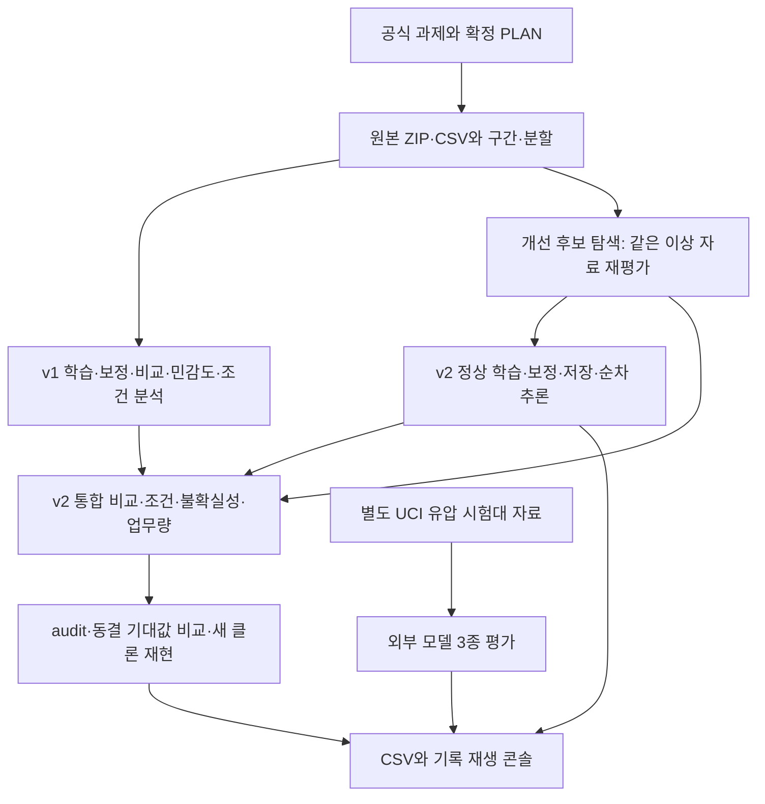

# 프레스 작업 전체 워크플로우 검수

검수 대상: `0afea457cd3a6faf99e23b38a552a9430f338c39` (2026-09-25). Codex.

**실행과 수치 재현은 확인됐다. 그러나 최종 v2에 대해 최초 계획의 검증·분석 항목까지 전부 완료됐다고 판정할 근거는 부족하다.** 특히 재적합을 포함한 전처리 민감도와 일부 오류 조건 분석은 v1 결과만 있다. 독립 날짜·새 고장에 대한 v2 성능은 검증되지 않았다.

이 문서는 구현 검수 기록이다. 대회 보고서·제출용 서술이 아니다. 모델, 전처리, 문턱, 기존 결과·기대값은 수정하지 않았다. 미추적 `yejun/power_submission/`은 검수·수정 대상에서 제외했다.

## 1. 판정 기준과 범위

- 요구사항: 로컬 공식 과제 공개 원문의 ③번, [확정 PLAN](../../press_submission/PLAN.md), 사용자 지시가 반영된 [AGENTS](../../AGENTS.md), v2 및 추가 실험의 명시된 프로토콜.
- 증거: 원본 ZIP/CSV, 현재 코드, 저장 모델, 직접 재실행·재집계, Git 변경 이력. 이전 검수자의 “완료”, “결함 없음”, “불가능”, “수상 가능”이라는 판정 문구는 증거로 사용하지 않았다.
- `확인`은 적힌 범위의 요구를 충족한다는 뜻이다. `부분`은 일부만 있고, `미확인`은 이번 검수에서 입증하지 못했으며, `보류`는 사용자 지시에 따라 진행하지 않는 항목이다. 테스트 개수로 완성도 점수나 수상 확률을 산출하지 않았다.
- PLAN은 v1 문서다. v2에서 바뀐 모델 산식을 v1 산식과 다르다는 이유로 결함으로 세지 않았다. 반면 **최종 모델의 강건성·FN/FP 분석이라는 과제 목적은 모델 변경 후에도 남는다.** 아래의 v2 누락 판정은 원래 완료 기준을 최종 모델에 적용한 결과이며, v1 결과가 잘못됐다는 뜻은 아니다.

전체 항목은 [requirements.csv](requirements.csv)에 요구·근거·판정·남은 조건을 연결했다.

## 2. 직접 확인한 실행 결과

| 실행 | 이번 확인 결과 | 범위 |
|---|---|---|
| v1 pytest | 49/49 | 현재 코드의 기존 단위·회귀 검사 |
| v2 pytest | 43/43 | 추론·경계·API·분석·검증 계약 |
| JS 회귀 | 4개 검사 묶음 통과 | null 점수, 빈 재생, 50,000행 차트, 빈 선택 |
| v1 새 클론 | verify 39/39, 집계 32개 수치 차이 0 | 1~5단계 재실행, **LSTM 캐시 사용** |
| v2 새 클론 | audit 14/14, verify 15/15, CSV 10개 수치 차이 0 | 원본만 복사 후 v1 주 예측→v2 학습/롤링→분석→audit→verify. 기준모델·LSTM 비교표는 커밋된 표 재사용 |
| 성능 개선 탐색 | 288행 재현, 바이트 동일 | press_improvement 후보 8개 전체 운영점 |
| v2 선정 탐색 | 180행 재현, 바이트 동일 | press_advance 후보 5개 전체 운영점 |
| 최신 위치 0·1 탐색 | 216행 재현, 바이트 동일 | press_early 후보 6개 전체 운영점 |
| 모델 상태 독립 대조 | A/B 차이 0 | 정상 학습 평균·척도·AR(2) 계수, 정상 보정 120구간 최댓값 |
| v2 운영점 재집계 | 6/6 일치 | A/B × α 1/3/5%, 순위 p값·TP/FP/FN/TN·구간 탐지·지연 |
| UCI 외부 결과 | 18/18 혼동행렬 일치 | 원본 특징/모델 함수 재실행 + 별도 순위·집계, 분할 교집합 없음 |
| Chrome 실제 조작 자동화 | 예외 0 | 탭, 구간 선택, α 변경, 재생, 0위치 호버, CSV 업로드/내보내기 |

근거: [current_checks.json](current_checks.json), [clean_repro_v1.txt](clean_repro_v1.txt), [clean_repro_v2.txt](clean_repro_v2.txt), [candidate_reproduction.json](candidate_reproduction.json), [facts.json](facts.json), [codex_browser_results.json](codex_browser_results.json).

이번 새 클론은 같은 macOS·기존 Python 3.12.2 환경에서 실행했다. 새로운 가상환경 설치, LSTM 전체의 캐시 없는 재학습, 다른 OS는 이번에 재실행하지 않았다. 과거 문서의 해당 실행 기록과 이번 직접 실행을 혼동하지 않는다. 브라우저 검사는 자동 조작이며 사람이 수행한 사용성 검증이나 공장 운전 시험이 아니다.

## 3. 계획에서 실행까지의 연결

v2 추론은 `press_submission/press` 코드에 의존한다. v2 통합 분석은 여기에 v1 비교표·예측 및 `press_advance` 결과도 필요하다. UCI 자료는 v2 학습 경로에 들어가지 않는다. 현재 재현은 저장소 구조를 유지한 경로에서 확인됐다. v2 폴더 하나만 떼어 낸 독립 배포물의 재현을 뜻하지 않는다. 최종 ZIP 조립은 사용자 지시로 보류 중이다.

| 원래 작업 단계 | 확인한 것 | 남은 구분 |
|---|---|---|
| W1·W6 데이터·진단·구간·분할 | ZIP 안 CSV = 공용 추출 CSV = 패키지 CSV SHA-256 일치. 600/21구간·분할·기초 진단 재현 | 정상·이상 날짜 교락은 제거되지 않음 |
| W2·W3·W4 학습·보정·추론 | 정상 학습/보정으로 적합, 과거 관측 창, 순위 p값, 저장/복원, 순차 추론 확인 | 후보 선택은 이상 평가 결과를 사용한 탐색 |
| W5·W9 강건성·절제·오류 조건 | v1의 3전처리×7창 재적합, 절제, 상호작용표 존재·재현. v2 후보 비교·입력 정밀도 스트레스·기본 조건표 재현 | v2의 재적합 민감도, 상호작용 및 진폭 신뢰 제한 분석은 미완료 |
| W7·W8 기준모델·LSTM·불확실성 | 동일 분할/보정의 기준모델 비교, 별도 가이드 프로토콜, coverage·블록 bootstrap·조건부 지연 | 같은 이상 자료 재사용. 이번 LSTM 재현은 캐시 사용 |
| W10 활용·지속성·진폭 후보 | v1 지속성/진폭 후보의 부정 결과까지 재현. v2 알림 큐·α별 업무량·원인 성분 표시 | v1 후보 결과를 v2에서 채택·검증한 정책으로 표현할 수 없음. 실제 현장 비용·가동 효과 미검증 |
| W11 재현·검수 | 현재 코드 테스트와 새 클론 재현 통과 | 아래의 검사 의미·CSV 계약 문제, 환경 확인 범위 |
| W12·제출 준비 | 사용자 지시로 보류 | 보고서·발표자료·최종 ZIP·문의 발송을 미구현 결함으로 세지 않음 |

## 4. 남은 항목 — 근거와 영향

### F1. 최종 v2의 전처리 강건성은 원래 계획의 두 검사 중 하나만 있다

- 기준: PLAN §3·§5.2 (`PLAN.md:68,132–133`). ① raw/matched/coarse 각각 학습·보정·평가 재실행, ② matched 학습·문턱 고정 후 평가 입력만 변경.
- 코드: [press_advance/run_experiment.py](../press_advance/run_experiment.py) 52–69행은 **matched로만 적합·보정**한다. [press_guard/analyze.py](../../press_guard/analyze.py) 77–86행은 그 결과를 복사한다. `GuardModel.fit`도 matched 고정이다.
- 판정: v1은 ①·② 모두 확인, 최종 v2는 ②만 확인. 기존 v1 `sensitivity.csv`에는 AR(2) 결합 v2가 없다.
- 영향: 현재 표로 확인 가능한 것은 입력 정밀도를 바꿨을 때의 고정 모델 반응이다. 전처리 변경에 따른 v2 학습 계수·참조 꼬리·보정 문턱의 안정성까지 검증됐다고 할 수 없다.
- 완료 조건: 최종 v2의 ①을 별도 실험으로 보완하거나, 이 검사를 생략한 범위·이유를 최종 계획에 명시해야 한다. 그 전에는 “v1과 같은 전체 강건성 검증 완료”로 표현하지 않는다.

### F2. 최종 v2의 오류 조건표가 계획의 조건 정의·분모를 모두 이어받지 않았다

- 기준: PLAN §1·§5.3 (`PLAN.md:20,142–144`). 진동×파형 2×2, 행·구간 분모, 짧은 구간·파형 적합 불량의 진폭 신뢰 제한.
- 코드: [analyze.py](../../press_guard/analyze.py) 112–152행. v2는 위치/길이/진동 사분위/진폭 사분위/가장 큰 성분의 **행 단위** 표만 생성한다. `amp_reliable`을 계산하지만 표에 반영하지 않는다. 진동×파형 상호작용, 파형 적합에 따른 신뢰 제한, 조건별 정상 알림 **구간** 비율은 생성하지 않는다.
- 추가 관측: 사분위는 정상 평가와 이상 평가에서 따로 산출된다. A의 진동 Q4 경계는 정상 약 0.0817, 이상 약 0.6676으로 다르다. 같은 Q4라는 이름을 동일한 센서 범위로 해석하면 안 된다. 이것은 사후 기술 통계이며 모델 학습 누출이라는 뜻은 아니다.
- 짧은 구간: 길이 17 미만은 이상 7구간·59행, 정상 평가 A 24구간·220행/B 35구간·322행이다. 현재 진폭 표에는 이 행들이 신뢰 제한 표시 없이 포함된다. 제외할 필요는 없지만 표시해야 계획과 맞는다.
- 근거: [condition_definition_audit.csv](condition_definition_audit.csv), `facts.json.v2_error_schema`. 기존 v1 상호작용·신뢰 제한 표는 **v1의 경보**를 사용하므로 v2 표의 대체물이 아니다.
- 완료 조건: v2 예측으로 조건별 구간 분모·상호작용·신뢰 제한을 계산하고, 공통 기준으로 비교하거나 각 사분위 경계를 결과에 저장한다.

### F3. 실행 검수의 알림 검사에 성능 조건이 섞여 있다

- 기준: PLAN §2 R8·§9. 정확성 검사와 성능 가설의 분리.
- 코드: [audit.py](../../press_guard/audit.py) 69–70행. `notification.sum()==1`을 **모든 이상 기록구간**에 요구하고, 알림 큐 길이도 전체 이상 구간 수와 비교한다.
- 반례: 한 구간은 탐지해 알림 1회, 다른 구간은 미탐이라 알림 0회를 내면 중복 알림 방지 동작은 맞다. 하지만 현재 검사식은 실패한다. [facts.json](facts.json)의 `notification_gate_probe`에서 현재 식은 false, `알림 수 == 해당 구간 alarm의 최댓값`은 true다.
- 영향: 현재 21/21 결과와 F1이 틀렸다는 뜻은 아니다. 향후 다른 모델 결과의 미탐을 실행 오류와 구별하지 못한다.
- 완료 조건: 구간당 알림 검사와 21/21 성능 회귀 검사를 별도로 이름 붙이고 판정한다. 전자는 `alarm`이 있으면 1회, 없으면 0회를 검사한다.

### F4. v2 추론 CSV가 원래 저장 결과 계약을 일부 빠뜨렸다

- 기준: PLAN §7 (`PLAN.md:182`), 각 예측에 모델 식별자·판정 가능 여부·기준을 연결.
- 코드: [model.py](../../press_guard/model.py) 157–160행, [predict.py](../../press_guard/predict.py) 18–26행.
- 관측: v2 결과에는 점수·p값·status·alpha·reason은 있으나 `model_id`, `criterion`, `is_scored`, `anomaly_score`는 없다. 일부는 현 열에서 계산할 수 있지만 v1↔v2 계약 대응이 명시돼 있지 않다. CSV만 전달하면 어느 모델/분할로 생성했는지 알 수 없다.
- 영향: 현재 웹과 CLI 동작 오류는 발견되지 않았다. 결과 파일을 별도로 전달·비교할 때 실행 출처 추적이 부족하다.
- 완료 조건: 모델/프로토콜/분할 식별자를 CSV 또는 함께 저장하는 메타데이터에 남기고, 변경된 출력 스키마와 구 버전의 대응을 문서화한다.

### F5. 최신 실험의 기록에 수량·선택 절차 표현 불일치가 있다

- [press_early/README.md](../press_early/README.md)의 전체 결과 “108행”은 전체가 아니다. 실제 `metrics.csv`는 **216행 = conformal 108 + cutoff 108**이다. 전부 재현됐다.
- [press_early/protocol.json](../press_early/protocol.json)의 “이상 라벨은 … 후보 선택에 사용하지 않음”과 같은 파일의 “이상 21/21 유지” 채택 기준은 함께 성립하지 않는다. 계수·문턱은 정상 자료로만 적합하지만, 채택 여부는 이상 탐지 결과도 참조한다.
- `registered_before_scores: true`는 파일의 선언이다. advance/early/external 모두 프로토콜과 결과가 같은 최초 커밋에 들어 있다([protocol_history.json](protocol_history.json)). Git 자료만으로 실제 기록 순서를 독립 입증할 수 없다. 이것이 사후 작성의 증거도 아니다. 실행 중 후보 목록 고정과 결과 전체 공개는 코드·재실행으로 확인된다.
- 최신 후보 판단 자체는 명시된 기준과 일치한다. joint 결합은 A 위치 0·1 미탐을 각 13→11로 줄이지만 B 정상 알림은 3→4, B 미탐은 그대로다. diff1은 주 운영점에서 개선이 없다([early_position_recount.csv](early_position_recount.csv)). 따라서 **시험한 설정과 두 분할을 모두 만족하는 채택 기준 안에서는** 교체 근거가 없다. 다른 설정·방법 전체의 불가능성을 입증한 실험은 아니다.
- 완료 조건: 행 수와 “정상만 사용하는 적합·보정 / 이상 결과도 참조하는 탐색적 후보 선택” 표현을 바로잡는다. 향후 사전 고정 순서를 입증하려면 결과와 분리된 프로토콜 커밋을 남긴다.

그 밖의 원안 세부 항목도 대응표에 남겼다. 미채택 진폭 정규화 후보는 정상 학습 앞 80%에서 계수를 적합하지만, 계획에 적힌 뒤 20% 시간 검증의 별도 지표를 출력하지 않는다(R21). 환경 manifest의 BLAS 값은 null이며, 전체 학습의 최대 메모리 측정 기록도 없다(R25). v2의 일부 성분 비교는 있으나 원안의 모든 절제를 v2에 적용한 결과는 없다(R15). 이 항목들을 현재 v2 성능 계산 오류로 해석하지 않는다.

## 5. 성능 해석의 경계 — 구현 결함과 별도

| 주 α=1%, matched | A | B |
|---|---:|---:|
| v2 TP / FN / FP | 556 / 44 / 0 | 569 / 31 / 3 |
| 전체 행 F1 | 0.961938 | 0.970990 |
| 정상 알림 구간 | 0/120 | 3/180 |
| 이상 알림 구간 | 21/21 | 21/21 |
| 최대 첫 경보 지연 | 기록 시작 후 0.5초 | 기록 시작 후 0.5초 |

표는 [v2_recount.csv](v2_recount.csv)의 독립 재집계다. v1 대비 미탐은 각 55행 감소했다. 주 기준에서 정상 알림 수는 같지만 B α=3/5%에서는 v2가 v1보다 한 구간씩 많고, coarse 입력 B에서도 한 구간 많다. 모든 운영점에서 오경보가 유지·감소했다는 결론은 성립하지 않는다.

1. **자료 구조:** 정상 20,000행/600구간은 2022-07-12, 이상 600행/21구간은 2022-07-17이다. 라벨과 날짜가 완전히 겹친다. 정상 날짜 차이와 펌프 이상 효과를 분리하는 비교 표본이 없다. 기록 관측시간 합은 정상 2,000초, 이상 60초이며 하루 연속 운전 데이터가 아니다.
2. **평가 재사용:** A/B 이상 자료는 동일하며, 정상 평가 A의 120구간은 B 평가에도 포함된다. 5회 롤링의 정상 평가 구간은 서로 나뉘지만 이상 21구간은 계속 같다. 후보 선택에 이미 사용한 자료이므로 최종 수치는 개발 자료상의 결과다. 정상만으로 계수를 적합한 사실과 독립 평가의 존재는 별개다.
3. **조기탐지 의미:** 실제 고장 발생 시각·정비 이력이 없어 0.5초는 기록 시작 기준이다. 고장 전 0.5초 예측, 잔여수명, 독립 고장 21회 검증으로 바꿔 말할 수 없다.
4. **불확실성:** α는 정상 보정 순위의 비교 기준이다. A의 0/120이 미래 오경보 0%라는 뜻은 아니다. 같은 하루의 블록 bootstrap은 다른 날짜·설비에 대한 검증을 만들지 않는다.
5. **추가 데이터:** UCI 원본 ZIP SHA-256, 2,205사이클과 1,449개 안정 사이클을 확인했다. 공식 설명은 다른 유압 시험대의 60초 사이클이며 센서·샘플링도 다르다([UCI 원문](https://archive.ics.uci.edu/dataset/447/condition+monitoring+of+hydraulic+systems), 2026-09-25 확인). 현 코드도 v2 가중치 대신 별도 모델 3종을 적합한다. 외부 자료 확보·별도 실험은 수행됐지만 대회 v2의 독립 검증 공백은 남는다. 환경 이동 실패 결과도 보존되어 있다.

위 1~5는 테스트를 추가 통과시켜 해소할 수 있는 항목이 아니다. 같은 센서 체계의 새로운 정상 날짜·운전 조건과 독립 이상/정비 근거를 확보하고, 동결된 모델로 평가해야 검증 범위가 확장된다. 아직 제공되지 않은 자료의 확보 가능성·성과·수상 여부는 이 검수에서 추정하지 않았다.

## 6. 다음 작업의 순서와 종료 조건

1. 최종 v2 기준의 요구사항 대응을 확정하고 F1·F2의 분석 공백을 메운다. 기존 평가 자료의 추가 분석이며 독립 검증이라고 부르지 않는다.
2. F3·F4·F5를 수정한 뒤 관련 회귀 검사와 학습→분석→audit→verify를 실행한다. 성능 산식을 바꾸지 않는 수정에서는 기존 수치 차이가 0인지 먼저 확인하고 검증 메타데이터를 갱신한다.
3. 새로운 성능 주장은 별도 날짜/조건의 동결 평가가 있을 때만 추가한다. 확보되지 않으면 미확인 상태를 유지한다.
4. 대회 보고서·발표자료·최종 ZIP은 사용자 지시 전까지 계속 보류한다.

이번 요청인 전체 검수는 완료했다. 위 미충족 항목을 수정 완료했다고 표시하지 않았으며, 모델 개선 실험이나 보고서 작성으로 범위를 확장하지 않았다.

## 실행 근거 파일

- [check_workflow.py](check_workflow.py): 데이터·정상 적합 상태·6운영점·최신 후보 위치·외부 18운영점 재계산. 원본과 모델은 읽기만 한다.
- [source_origin.json](source_origin.json): 대회 ZIP 내부→공용 CSV→패키지 CSV 해시 일치.
- [facts.json](facts.json), [recount_log.txt](recount_log.txt): 재계산 결과와 환경.
- [requirements.csv](requirements.csv): 전체 계획 대응표.
- [candidate_reproduction.json](candidate_reproduction.json), `*_rerun.txt`: 3개 탐색의 별도 출력 재현.
- [clean_repro_v1.txt](clean_repro_v1.txt), [clean_repro_v2.txt](clean_repro_v2.txt): 최신 커밋의 새 클론 실행 로그.
- [codex_browser_results.json](codex_browser_results.json), [codex_console.png](codex_console.png): 현재 UI 실제 자동 조작 결과. 실행기는 기존 `press_guard_review/codex_browser_check.py`를 사용하고 출력 경로만 이 폴더로 지정했다.
