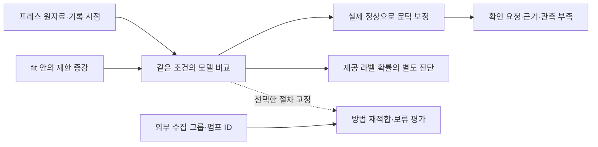

# 프레스 유압펌프 통합 실행 계획

2026년 10월 3일 작성·실험·설계 재검수 반영. 최초 계획의 입력 기준은 `b9dd7bd`, 핵심 검증의 원명세는 `d772d8e`다. **현재 실행 순서는 [수정 계획](07_validation_revision.md), 후속 수식·선택·예외 처리는 [실행 전 확정 명세](08_execution_contracts.md)**를 따른다. 최초 수치 명세는 과거 실험의 재현 근거로 보존한다.

전략은 **정상 확인 부담과 작은 변화·감소형 이상 탐지를 함께 검증하고, 외부 수집 그룹에서 적용 범위를 확인하는 것**이다. 전류 조건부 기준은 하부 진동에서 일부 이익을 보였지만 원명세와 후속 개선안 모두 전체 채택 조건을 통과하지 못했다. 최종 모델은 미정이며 B1은 비교 기준으로 유지한다. 다음 우선 작업은 SKAB 개발 계약과 정상 기준·문턱 문제의 검증이다.

원자료·출처·외부 데이터 확보 감사에 이어 핵심 가설 7설정과 후속 개선안 6개를 구현·실험했다. 새 후보 12개 중 전체 기준 통과는 0개다. 계산 계약 24개와 새 환경의 재실행에서 집계 36파일 일치를 확인했으며, 이것은 모델 채택 성공과 구분한다. 학습 증강·외부 모델 test·확률 헤드·현장 실증·대회 보고서·발표자료는 아직 수행하지 않았다. [검증 패키지](../../analysis/press_master_validation_2026-10-03/README.md), [현재 상태](execution_revision.json)

## 이 계획이 합친 강점

| 원안 | 유지할 강점 | 이번 수정 |
|---|---|---|
| [Claude 통합안](../press_plan_merged_2026-10-02/README.md) | 원자료의 조건 변화 진단, 전류 정보 부족 경로, 변화 크기별 탐지 곡선, 단계마다 실행 가능한 구현, 현장 확인 절차 | 실제 단위·정지 상태의 단정 제거, 보류 시험으로 후보를 고르던 규칙 수정, 교차 보정·경보 예산의 과도한 보장 제거 |
| [Codex 통합안](../press_unified_2026-10-02/README.md) | 공정한 기준 비교, 실제 정상 보정, 동일 학습량 증강 대조, 예측 시점 구분, 외부 시험 예약, 실패를 허용하는 선택 | 중복 수집 그룹 통제, 커버리지 재계산, 외부 데이터 취득·검수. 과거 v2는 참고 이력이며 복귀 경로에서 제외 |

모든 기능을 합치는 방식은 채택하지 않는다. 조건부 점수, 새 표현, 증강, 순차 정책, 기준 갱신을 한꺼번에 바꾸면 개선의 원인을 알 수 없다. 각 변경은 같은 입력·분할·판정 시점의 대조군을 둔다. 상세 채택·수정 근거는 [비교와 오류 정정](01_comparison.md)에 있다.

## 이번에 확인한 결정적 사실

| 확인 결과 | 실행에 미치는 영향 | 근거 |
|---|---|---|
| 정상 20,000행 중 완전 중복 1행. 공통 규칙에서 정상 599기록, 이상 600행·21기록 | 이상 21기록을 독립 고장 21건으로 세지 않는다 | [원자료 감사](evidence/press_audit.json) |
| 정상 69기록·이상 4기록은 10표본 미만. 이상에서 20표본 이상은 13기록뿐 | 짧은 기록을 평가에서 빼지 않고 축소 특징·확인 필요 상태를 남긴다 | 같은 감사 |
| 원명세 B1→C1의 개발 정상 요청은 14→13건. 감소·전류 무효 손실 제한은 실패 | 조건부 기준의 이익을 가정하고 최종 모델로 진행하지 않는다 | [13설정 집계](../../analysis/press_master_validation_2026-10-03/evidence/comparison.csv) |
| 원명세 P2 B1 요청은 33건, 길이별 척도를 제거한 진단은 10건 | 길이별 기준과 전체 보정 문턱의 상호작용을 검수한다. P2는 새 독립 시험이 아니다 | [명세 요소 대조](../../analysis/press_master_validation_2026-10-03/evidence/diagnosis/length_ablation.csv) |
| 단순 규칙의 예제 시험 F1은 자기 창만 사용하면 0.819672, 전체 기록 판정을 소급하면 1.000 | 두 숫자는 입력 정보와 판정 시점이 다르다. 같은 순위표에서 직접 우열을 주장하지 않는다 | 같은 감사, [재계산 출력](evidence/legacy_recalculation.txt) |
| SKAB 35파일에서 동일 시각·센서값 중복 관계 5쌍 발견. 기존 분할의 학습·시험 사이에도 21행 중복 | 수집 겹침을 연결해 30그룹으로 재분할. 중복 제거는 학습과 평가 모두에 적용 | [새 그룹 예약](evidence/skab_group_reservation.json) |
| 같은 SKAB 관측의 주석이 237개에서 충돌하며 그중 235개는 anomaly 라벨이 다름 | 확인된 정상 학습·보정에서 제외. 평가에는 모호한 라벨의 범위와 커버리지를 남김 | [주석 검사](evidence/skab_label_consistency.json) |
| Beihang 정상 1번은 11개 신호가 각각 시간축을 가짐. 출력 압력은 약 3 kHz 간격이며 논문 표의 1 kHz와 다름 | 행 번호 결합 금지. 1차 비교는 검수된 진동·속도만 사용하고 압력·유량은 별도 검수 전 제외 | [외부 구조 감사](evidence/external_audit.json) |
| ESPset 특징은 6,032개, 펌프 ID 11개, 각 ID에 여러 라벨 존재 | 개체를 나누는 보조 검증이 가능. 원시 시계열·발생 시각 자료로는 사용하지 않음 | [ESPset 감사](evidence/espset_audit.json) |
| 1 kHz 가설에서 1 ms/표본으로 환산한 정상 관측 분량은 약 20초, 경과시간 대비 약 0.433% | 기존 약 0.6%는 최대 50표본과 대표 간격을 쓴 근사다. 실제 취득률·연속 관측 커버리지는 여전히 미상 | [원자료 감사](evidence/press_audit.json) |

## 하나의 연구 질문과 판정

**질문:** 관측 전류 조건을 고려하면 전역 기준보다 정상 확인 요청을 줄이면서, 작은 진동·전류 변화와 전류 정보 부족 상황의 탐지력을 유지할 수 있는가?

조건부 정상 기준은 전류를 실제 부하로 확정하지 않고 관측 대리값으로 쓴다. 조건화가 불가능하면 전역 진동 기준으로 돌아간다. 전류 자체의 변화 점수는 남긴다. 저하 방향을 놓칠 수 있는 단측 모델은 양측 모델의 도전자이며 자동 승자가 아니다.

성공은 세 종류로 구분한다. 프레스에서의 개선은 **이미 본 자료에서의 탐색 결과**, 합성에서의 개선은 **정의한 신호 변화에 대한 민감도**, 외부에서의 개선은 **해당 장치·개체의 새 평가 그룹에서 재적합한 방법의 성과**다. 이 세 결과를 합산해 프레스 현장 고장 일반화라고 부르지 않는다.

가장 강한 반론은 전류도 고장이나 수집 경로 변경의 영향을 받는다는 점이다. 이번 감소·전류 무효 시험에서는 조건부 모델의 손실이 실제로 남았다. 전역 경로의 점수가 같아도 전체 정상 보정 문턱이 달라 판정이 달라질 수 있었다. 전역 모델도 후반·짧은 기록 검증을 통과한 최종 모델로 자동 승인하지 않는다.

## 실행 순서

| 단계 | 끝났을 때 남는 것 | 다음 단계 조건 |
|---|---|---|
| 완료한 핵심 검증 | 프레스 데이터 계약, 7설정과 개선안 6개, 개발 주입·손실·P2 감사, 재현 | 새 후보의 전체 채택 조건은 미충족 |
| 다음 외부 개발 | SKAB fit/dev/cal 어댑터와 전역·조건부 두 구조 | 그룹·충돌·시점 계약과 dev 표 완성 |
| 정상 기준과 증강 | 고정한 K1 보정 대조, A0/A1/A2 대조 | 기존 부담·민감도·손실 기준 유지, seed 선별 금지 |
| 확률·정책 개발 | 명시한 라벨 확률과 상수 비교, 즉시/2-of-3 개발 비교 | 외부 test 전에 전체 정책 동결 |
| 보류 시험과 최종 재현 | H1/H2, SKAB test, 선택적 Beihang 보조, 한 명령 검수 | 실패를 포함한 주장 범위 확정 |

현재 순서·축소 범위는 [수정 실행 계획](07_validation_revision.md), 기능별 계약은 [구현과 검수](05_execution.md)에 명시했다. 대회 마감은 2026년 10월 3일 확인한 공지 기준 10월 8일 23:59 KST다. 조사에 시간을 충분히 쓰는 것과 대회 일정은 별개로 관리한다. 현재 저장소 지시에 따라 보고서·발표자료 작성은 별도 착수 지시 전까지 보류한다. [공식 공지](https://www.kamp-ai.kr/noticeDetail?NOTICE_SEQ=86)

## 확보한 데이터와 역할

| 자료 | 이번 확보 상태 | 허용할 연구 질문 |
|---|---|---|
| UCI Hydraulic | 기존 76,601,704바이트 ZIP의 SHA-256·전체 CRC 재검사 | 냉각기 등 조건이 달라질 때 펌프 누설 점수의 실패 분석. 이미 사용한 자료 |
| SKAB 고정 GitHub판 | 센서 CSV 35개, 4,392,581바이트와 원 README·LICENSE 확보 | 새로운 수집 그룹의 변화 탐지·정상 요청·지연. 기존 파일 분할은 폐기 |
| Beihang v1 | 196,394,316바이트 ZIP, 11개 CSV, 게시 SHA-256 일치·CRC 통과 | 진동과 관측 속도의 조건부 관계, 인위적 마모 상태. 정상 회차 2개라는 제약 |
| ESPset v3 | 특징·스펙트럼 ZIP 합계 115,324,308바이트, 게시 SHA-256 일치·CRC 통과 | 펌프 ID별 외부 적용성, 센서 결함과 기계 라벨의 구분. 조기탐지 지연 제외 |
| NLN-EMP v4 | 공식 메타데이터·20.8 GB 중첩 압축의 디렉터리 확인 | 전류·진동 고장 종류 확장 후보. 센서 원자료 취득 완료로 세지 않음 |

원자료는 Git 제외 경로에 보관한다. GitHub에는 취득 스크립트·출처·해시·사용 명세를 올린다. 다른 모델은 [데이터 확보와 사용 명세](03_data_sources.md)의 명령으로 같은 자료를 준비할 수 있다. 외부 CSV를 프레스 학습 행에 직접 붙이지 않는다.

## 다음 검수자가 읽을 순서

0. [실행 전 확정 명세](08_execution_contracts.md)와 [기계 판독 계약](execution_contracts.json), [실험 결과와 수정 순서](07_validation_revision.md): 다음 구현의 수식·분모·선택·실패 처리는 무엇인가. [계획 검토 기록](evidence/plan_review.json)은 발견한 공백과 해결을 추적한다.
1. [비교와 오류 정정](01_comparison.md): 무엇을 왜 채택하거나 버렸는가.
2. [모델과 평가 명세](02_protocol.md) 및 [고정 설정](protocol.json): 구현자가 자의적으로 바꿔서는 안 될 정의.
3. [데이터 확보와 사용 명세](03_data_sources.md): 실제 파일, 출처, 라이선스, 외부 검증 분할.
4. [데이터 부족과 증강](04_augmentation.md): 어떤 부족을 어느 증거로 메우는가.
5. [실행과 검수](05_execution.md): 산출물 계약, 루브릭 대응, 완료·중단 기준.
6. [반론과 남은 한계](06_review.md): 이 계획을 기각할 조건과 미해결 질문.

진행 상태와 실행 우선순위는 **`execution_revision.json`과 07 문서**, 후속 구현의 추가·변경은 **`execution_contracts.json`과 08 문서**를 따른다. 원명세 재현의 수치 기준은 **`protocol.json`·02 문서와 검증 패키지의 `design_v1.json`**이다. 상충하는 수치가 있으면 구현자가 선택하지 않고 명세 오류로 처리한다. 과거 결과와 채택 문턱은 소급 변경하지 않는다.

이번 설계 검수는 실제 데이터에서 새 모델을 평가하지 않았다. [정적·가상 입력 검사](evidence/plan_contract_verification.json)는 분기·동점·FFT 불변성·분모 산식 등 실행 전에 검사할 수 있는 계약만 다룬다. 외부 성능·증강 효용·확률 성능·운영 결과는 여전히 미실행이다.
