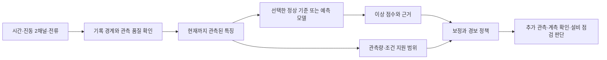

# 프레스 재설계: 경쟁 접근법과 실패조건

2026-10-01 · [전체 계획](README.md) · [출처·데이터](01_sources_and_data.md) · [검증·실행](03_validation_and_execution_plan.md) · [증강 계획](04_augmentation_plan.md)

**이 문서의 알고리즘 구성·파라미터·채택 조건은 앞으로 검증할 제안이다.** 논문에서 보고한 결과와 우리 데이터에서 얻은 결과로 혼동하지 않는다. 후보를 넓게 비교하되 최종 구조에 모두 넣는 것을 목표로 삼지 않는다.

## 1. 접근법을 비교하는 공통 질문

좋은 후보는 다음 중 하나를 실제로 개선해야 한다.

- 정상 운전 조건이 바뀔 때의 불필요한 확인 요청.
- 같은 오경보 부담에서의 약한 이상 또는 느린 변화 탐지.
- 같은 탐지 수준을 얻기 위해 필요한 정상 참조 데이터량.
- 관측 부족·계측 변화에서 잘못된 확신을 줄이는 능력.
- 최악 조건에서의 안정성과 구현·운영 비용.

행 F1 0.01 상승만으로 새 주력을 선택하지 않는다. 반대로 복잡성을 이유로 딥러닝을 미리 배제하지도 않는다. 데이터 단위와 경보 정책을 맞춰 이익을 설명할 수 있는지가 기준이다.

## 2. 공통 입력·출력 설계

이는 공통 비교 틀이다. 화면·서비스 구현 설계가 아니다. 운영 출력은 점수, 이용한 관측 구간, 정상 기준과의 차이, 자료 부족 여부, 권장 확인 항목으로 구성한다. 고장 원인 라벨이 없으므로 “베어링 고장 확정” 같은 출력을 기본안에 넣지 않는다.

## A. 운전 조건을 고려한 정상 기준

**가설:** 정상의 신호 크기나 상태 전환이 전역 문턱을 넘는 것이 주요 FP 원인이라면, 비교할 정상 범위를 맞추는 편이 유리하다. 기존 B의 FP가 신호로 추정한 부하 상태에 집중된 것이 탐색 근거다. 이는 실제 부하 원인이 확인됐다는 뜻은 아니다.

**경쟁 가설:** 단순히 상위 꼬리 문턱을 조금 높이면 같은 이득을 얻을 수 있고, 상태 모델은 고장도 정상으로 흡수할 수 있다.

| 설계 요소 | 최소안 | 확장안 |
|---|---|---|
| 조건 표현 | 과거/현재까지 전류 수준·RMS·변화량, 관측 길이 | 실제 PLC 단계·속도·압력·유온이 있으면 이를 우선 |
| 정상 모델 | 전역 robust scaling + shrinkage covariance 또는 kNN | 정상 학습만으로 K=2/3 혼합모형, 조건부 회귀 잔차 |
| 비교 | K=1 전역 기준과 같은 특징·문턱 정책 | 상태를 모르는 전역 모델 대 실제 상태를 아는 모델 |
| 이상 점수 | 상태별 평균·산포에서의 거리 | 예측된 진동 수준 대비 잔차와 관계 변화 |
| 보정 | 조건화 점수를 하나의 정상 보정셋으로 보정 | 충분한 자료가 생길 때에만 상태별 보정 |

후보 식은 `진동 특징 − E[진동 특징 | 운전 대용 특징]`의 잔차다. 전류만 바뀌는 고장이 정상 조건으로 흡수되지 않도록 **전역 전류 변화·원 크기 점수도 별도 감시**한다. 이 추가 경로까지 포함해 최종 경보 부담을 보정한다.

현재 정상 보정 120개를 두 상태로 나누면 각 상태에서 1% 꼬리를 안정적으로 다룰 수 없다. pooled 보정으로 전체 기준을 비교하고 상태별 오차를 따로 표시한다. 조건별 보장을 갖췄다고 표현하지 않는다.

**최소 실험:** 전역/2상태/조건부 잔차를 같은 입력으로 비교한다. 정상 높은 수준 구간·전환 구간, 전류만 변한 경우, 진동만 증가한 경우를 따로 본다. 실제 조건 라벨이 있는 UCI/Beihang에서 상태를 사용했을 때와 사용하지 않았을 때를 비교한다.

**채택:** 같은 탐지 요구에서 최악 상태의 확인 요청이 줄고, 전역 문턱 완화보다 나아야 한다. **중단:** 상태가 날짜/파일 라벨을 재현하거나, 원 전류 이상을 지우거나, 작은 상태의 표본 부족으로 결과가 크게 흔들릴 때.

선행 근거: [Yu·Qin의 다중 모드 연구](https://aiche.onlinelibrary.wiley.com/doi/10.1002/aic.11515). 현재 관측 전류를 실제 제어 입력 대신 사용하는 부분은 우리 데이터 제약에 따른 제안이다.

## B. 빠른 변화와 느린 변화의 분리

**가설:** 짧은 파형 훼손을 잡는 점수와 지속적인 수준·산포 변화를 잡는 통계가 서로 다른 이상을 보완한다. 기존 UCI 적용 실패와 일부 인공 변화의 사각지대가 탐색 근거다.

**경쟁 가설:** 느린 통계는 정상 운전 전환을 누적해 FP만 늘리거나, 이미 있는 크기 성분과 중복된다.

| 경로 | 입력과 방법 | 시간 처리 |
|---|---|---|
| 빠른 경로 | 개별 관측의 robust 크기, 짧은 AR/선형 예측 잔차, 선택적으로 작은 TCN | 기록 경계에서 내부 문맥 초기화. 필요한 과거 관측이 모일 때까지 해당 성분 미출력 |
| 느린 경로 | 기록 수준 평균·중앙값·RMS·센서 관계 잔차의 EWMA/CUSUM | 상태가 비교 가능하고 관측이 충분한 기록만 순서대로 사용 |
| 최종 결합 | 각 경로를 별도 표시한 뒤 정상 자료로 결합 보정 | 둘 중 하나가 울리는 정책과 단일 경로를 공정하게 비교 |

초기 후보 창은 기록 안의 3/10/20/50행 중 유효한 길이만 고려한다. 1~2행에서 가능한 크기 점수와 20행 이상이 필요한 관계 특징의 이용 가능 시점을 구분한다. 성분이 없는 구간을 정상으로 대체하지 않는다.

공백을 넘어 원시 파형을 이어붙이지 않는다. 느린 경로는 기록 요약의 관측 순서를 쓰는 방식과 실제 경과시간으로 가중치를 조정하는 방식을 구분한다. 장시간 미관측은 정상 증거가 아니며, 오래된 요약은 만료/보류 조건을 갖는다.

**최소 실험:** 빠른 단독, 느린 단독, 결합을 동일 경보 예산에서 비교한다. 점프·램프·산포 증가·일시 충격의 반응을 분리하고 정상 상태 전환도 함께 평가한다. 주입된 램프의 성공을 자연 열화 예측이라고 부르지 않는다.

**채택:** 새 변화 유형의 탐지를 늘리면서 전체 작업자 부담을 감당할 수 있을 때. **중단:** 공백 길이나 시동 단계에 점수가 지배되거나, 단순 평균 문턱보다 이득이 없거나, 느린 고장을 적응 과정에서 흡수할 때.

기술 근거: NIST의 [CUSUM](https://www.itl.nist.gov/div898/handbook/pmc/section3/pmc323.htm)·[EWMA](https://www.itl.nist.gov/div898/handbook/pmc/section3/pmc324.htm). 관리도의 일반식과 현재 종속·가변 길이 기록에서 유효한 문턱은 별개다.

## C. 상·하부 진동과 전류의 관계 모델

**가설:** 공통 운전 변화로 세 채널이 함께 움직일 때는 관계가 유지되고, 일부 이상에서는 관계가 깨질 수 있다.

**경쟁 가설:** 관계 변화도 센서 부호·장착·날짜·샘플링 변화로 생기며, 짧은 창의 상관은 노이즈가 크다. 기존 정상/이상의 상관 부호 차이를 고장의 인과 증거로 삼지 않는다.

최소 후보는 세 가지다. 첫째, 학습 정상의 공분산에 대한 Mahalanobis 거리와 PCA 잔차. 둘째, 한 채널을 다른 채널과 그 과거 값으로 예측한 교차 잔차. 셋째, 개별 크기와 상·하부 차이/비율의 결합이다. 비율은 분모가 작은 구간에서 폭주하지 않도록 조건을 정한다.

상관은 충분한 길이에서만 계산하고 길이별 불확실성을 표시한다. 상대 비교를 위해 채널을 독립적으로 매번 z-score 처리하면 공통 크기 이상이 사라질 수 있으므로, 원 크기와 관계 특징을 분리한다. 세 채널만 있는 상황에서 큰 GNN을 쓰는 것은 필수 요소가 아니다.

**최소 실험:** 개별 채널 점수 대비 관계 특징 추가의 이익을 본다. 채널별 부호 반전·시간 지연·스케일 변화와 실제 이상 예시를 대조한다. 이런 변환은 계측 이상일 수도 있으므로 “라벨 보존 정상 증강”으로 일괄 지정하지 않는다.

**채택:** 관계 특징을 제거할 때 조건별 성능이 일관되게 떨어지고 계측 변화에 대한 설명이 가능할 때. **중단:** 관계가 전체 파일을 식별하는 데만 유리하거나, 미래 값 정렬이 있어야 성능이 나오거나, 단순 두 채널 크기 기준과 차이가 없을 때.

## D. 목표 환경의 확인된 정상 기준을 이용한 적응

**가설:** 새 날짜·설비·운전 조건에서 전역 문턱을 그대로 쓰는 것보다, 그 환경의 확인된 정상 참조로 중심·산포를 다시 맞추면 부담이 줄어든다.

**경쟁 가설:** 그 과정이 고장까지 정상화하거나, 평가 구간을 미리 본 것과 같은 누수가 생긴다.

다음 네 조건을 나란히 비교한다.

1. 기존 모델·기준을 그대로 적용.
2. 모델은 고정하고 목표 정상 참조로 중심·산포만 조정.
3. 목표 정상 참조로 경보 문턱만 보정.
4. 특징 표현과 문턱을 함께 조정하되 조정 단계별 정상 자료를 분리.

참조는 실제 건강 상태가 확인된 수집분이어야 한다. “점수가 낮으므로 정상”이라는 기준으로 들어온 데이터를 즉시 재학습에 쓰지 않는다. 참조량 곡선은 예를 들어 10/30/60/120개의 **회차 또는 기록 단위**로 그리되, 같은 원기록을 잘라 표본 수를 늘리지 않는다. 60개면 충분하다는 사전 결론은 두지 않는다.

PHM의 목표 개체 정상 참조는 이 질문에 직접 맞는 설계다. UCI의 조건 이동은 다른 부품 상태 변화까지 포함할 수 있어 정상 조건의 의미를 먼저 정의해야 한다. AI4EU는 건강 확인 이력이 없으면 정상 참조의 진위를 확정할 수 없다.

**채택:** 목표 고장 라벨 없이, 같은 탐지 수준에서 새로운 환경의 경보 부담이 개선될 때. **중단:** 미래 평가 통계·고장 라벨·날짜 라벨을 적응에 쓰거나, 확인되지 않은 정상 혼입에 쉽게 붕괴할 때.

선행 근거: [PHM 2022 공식 과제](https://data.phmsociety.org/2022-phm-conference-data-challenge/)와 [정상 참조를 이용한 접근](https://www.papers.phmsociety.org/index.php/phmconf/article/view/3408). 프레스에서 날짜와 라벨이 얽힌 상태로 도메인 정렬만 적용하면 고장 차이까지 지울 수 있다.

## E. 지도·약지도 모델과 확률 출력

**가설:** 제한된 라벨을 쓰는 간단한 모델이 정상 전용 모델보다 좋은 판단 경계를 만들 수 있다. 공식 평가지표의 확률 예측 요구도 명시적으로 다뤄야 한다.

**경쟁 가설:** 단일 이상 파일의 고유 성질을 외운 결과여서 새로운 고장·날짜에서는 무너진다. 기존 이상 21기록을 나눈 검증은 이를 해소하지 못한다.

후보는 정규화 logistic regression과 얕은 gradient boosting이다. 입력은 시점까지 계산 가능한 같은 특징으로 맞춘다. 정상 전용 기준선과 비교할 때 사용한 이상 라벨 수를 반드시 별도 열로 표시한다. 지도 모델이 우수해도 라벨 비용과 검증 범위가 다르다.

출력의 의미를 세 층으로 구분한다.

| 값 | 의미 | 허용되지 않는 해석 |
|---|---|---|
| 이상 점수 | 선택한 모델에서 정상 기준과 다른 정도 | 그 자체를 고장 확률로 읽기 |
| 정상 참조 p값 | 정한 정상 기준에서 이 점수 이상이 얼마나 드문지 | `1−p`를 고장 확률로 부르기 |
| 제공 라벨 조건의 추정 확률 | 현재 학습·평가 구성의 `Equipment_state`에 대한 모델 추정 | 실제 현장의 고장 유병률·발생 확률로 확정 |

확률보정은 별도 검증 자료가 있을 때 학습한다. 현재 자료에서는 보정 전후 Brier/log loss를 내부 진단으로 볼 수 있지만, 독립 고장 사건에 대한 교정 검증으로 쓰지 않는다. 몇 개 bin의 ECE가 낮다는 이유로 잘 보정됐다고 결론내리지 않는다.

**채택:** 같은 사후 탐색 조건에서 이익과 한계를 정직하게 설명할 수 있고, 외부 회차/개체 분할에서도 지지될 때. **중단:** `Equipment_state`, 파일명, 날짜, 저장 자릿수 또는 평가 라벨로 정한 문턱이 성능을 지배할 때.

참고: [Guo 등 확률보정 연구](https://proceedings.mlr.press/v70/guo17a.html). 현장 확률 식별에는 추가 사례·유병률·독립 검증이 필요하다는 판단은 현재 데이터 구조에서 도출한 것이다.

## F. 특징·표현학습·사전학습 모델

**가설:** 직접 만든 사인/AR 특징에 덜 의존하는 표현이 운전 조건·이상 형태가 바뀔 때 유리할 수 있다.

**경쟁 가설:** 짧은 기록과 작은 유효 표본에서 사전학습·신경망의 이익이 없거나, 정규화·패딩·미래 문맥이 겉보기 개선을 만든다.

| 단계 | 후보 | 진행 조건 |
|---|---|---|
| 가벼운 특징 | 평균·산포·차분·관계 + catch22/24 일부 | 특징이 해당 길이에서 정의되고, 크기 정보가 보존됨 |
| 랜덤 변환 | ROCKET 계열 + 선형 분류/정상 거리 | 짧은 길이·채널 처리와 연산 부담 확인 |
| 작은 시계열 모델 | causal TCN, 작은 AE/LSTM 또는 TS2Vec | 공백·미래 정보·동일 원기록 누수 차단 |
| 사전학습 도전자 | MOMENT 한 변형 또는 긴 자료의 TSPulse | 모델 카드의 길이·배포 조건·사전학습 데이터 확인 |

현재 프레스에 모든 후보를 실행하는 것이 기본 계획은 아니다. 가벼운 특징 하나, 작은 시계열 모델 하나를 먼저 비교하고 이익의 근거가 있을 때 사전학습 후보 하나를 추가한다. 모델별 탐색 예산은 미리 제한한다.

공식 [MOMENT config](https://huggingface.co/AutonLab/MOMENT-1-large/blob/main/config.json)는 길이 512이며, [TSPulse AD 안내](https://huggingface.co/ibm-granite/granite-timeseries-tspulse-r1)는 더 긴 입력을 요구한다. 프레스 50행을 512행으로 보간하거나 공백을 없애 이어붙여 동일 입력 조건이라고 하지 않는다. 복원 모델이 현재 값 뒤의 미래를 사용한다면, 그 결과는 실시간 조기 탐지 비교에서 제외하고 별도의 오프라인 결과로 표시한다.

**최소 실험:** 원 크기 특징, 동역학 특징, 학습 표현을 같은 얕은 분류기/거리 모델에 넣어 표현의 효과부터 분리한다. 그 뒤 end-to-end 모델을 비교한다. 무작위 초기화 모델과 사전학습 모델의 차이도 필요한 경우 확인한다.

**채택:** 같은 입력 시점·동일 평가 단위에서 최악 조건 또는 새로운 이상 유형의 이익이 계산 비용을 정당화할 때. **중단:** 패딩 비율·창 길이·저장 형식으로 분류하거나, 미래 문맥이 없으면 이익이 사라지거나, 작은 기준선과 차이가 없을 때.

## G. 관측 신뢰와 판단 유보

**가설:** 관측이 짧거나 계측 설정이 바뀐 상황에 별도 상태를 표시하면, 잘못된 원인 확정과 불필요한 설비 정지를 줄일 수 있다.

**경쟁 가설:** 기존 FP를 “계측 확인”으로 이름만 바꾸거나, 어려운 이상을 유보 처리해 성능이 좋아 보일 수 있다.

최소 설계는 모델과 독립적인 관측 품질 항목이다. 시간 역행·중복·과도한 공백·채널 누락·상수화·포화 후보·새 수치 격자·지원 범위를 표시한다. 값이 크다는 이유만으로 데이터 오류라고 판정하지 않는다. 품질 점검과 이상 점수는 함께 남긴다.

운영 출력 예시는 “관측이 부족해 관계 판단 불가”, “전류 기준 변화가 커 계측 설정과 운전 조건 확인”, “두 진동 채널의 지속 변화로 설비 점검 후보”다. 현재 데이터만으로 계측 오류와 실제 고장을 분류했다고 하지 않는다.

**최소 실험:** 품질 표시 유무에 따른 탐지 결과, 자동 판단 비율, 유보된 이상 수, 전체 확인 요청 수를 함께 비교한다. 점검 요청에 걸린 시간을 가정한 민감도 분석은 가능하지만 실제 절감액은 현장 자료 없이 계산하지 않는다.

**채택:** 자동 결정의 오류가 줄고 총 확인 부담과 유보 위험이 투명할 때. **중단:** FP가 다른 이름으로 옮겨갈 뿐이거나, 이상 유보를 평가에서 삭제할 때. G는 공식 AI 모델 비교를 대체하는 단독 주력이 아니다.

## H. 점수에서 경보로 넘어가는 순차 정책

**가설:** 한 번 큰 점수와 지속적인 변화를 다르게 처리하면 작업자 부담을 줄일 수 있다.

**경쟁 가설:** 경보를 늦추거나 횟수를 제한한 것뿐이라 실제 탐지 개선이 없다.

비교 정책은 즉시 문턱, k-of-m 관측, EWMA/CUSUM, hysteresis와 일정 시간 내 동일 원인 묶기다. 최소 후보만 선택한다. 짧은 기록에서 k-of-m이 충족되기 전에 끝나는 상황과, 공백 중 계속 이상이었다고 추정하는 오류를 따로 다룬다.

모델 비교에서는 정책을 동일하게 고정한 결과를 먼저 보고, 각 모델의 최적 정책은 두 번째 표에 둔다. 정책 전체의 경보 단위를 정상 자료로 보정한다. 단일 시점의 유효한 p값이 있다고 무제한 반복 관찰의 경보 횟수가 자동으로 보장되지는 않는다.

**최소 실험:** raw exceedance 수, 묶인 알림 수, 재알림, 첫 탐지 지연, 누락된 사건을 동시에 기록한다. “하루 최대 3회 표시”와 “정상에서 하루 3회 이하 오경보”는 다른 요구다.

**채택:** 동일 탐지 요구를 유지하면서 확인 요청이 줄 때. **중단:** 상한을 넘는 경보를 숨기거나, 경보가 늦어진 사건을 분모에서 빼거나, 현재 공백 많은 자료를 연속 8시간처럼 환산해 효과를 주장할 때.

참고: [ISA 경보 관리 개요](https://www.isa.org/standards-and-publications/isa-standards/isa-18-series-of-standards), [conformal p값의 보장 범위](https://arxiv.org/html/2104.08279).

## I. 물리 모델과 디지털 트윈

**가설:** 압력·유량·회전수·토크가 있으면 정상 운전 변화와 효율 저하를 구분할 더 직접적인 특징을 만들 수 있다.

**현재의 제약:** 프레스 원본에는 이 변수와 정확한 펌프 기종이 없다. 전류만으로 모터 축출력이나 유압 효율을 확정할 수 없다. `Δp×Q`와 축출력의 비교 같은 구조를 쓰려면 측정 단위·동기화·손실 조건이 필요하다.

장기 후보는 유압 회로 시뮬레이션, 정상 상태의 물리 잔차, 상태별 효율·누설 지표다. [OpenHydraulics](https://github.com/modelica-3rdparty/OpenHydraulics)는 회로 가설 검토의 도구 후보이며 실제 마모의 진동 신호를 검증된 방식으로 대량 생성해주는 자료로 간주하지 않는다.

**최소 선행 작업:** 사용할 실제 변수·펌프 타입·경계조건을 명시하고 정상 운전 응답부터 검증한다. 시뮬레이션 고장은 합성 자료로 별도 표시한다. 합성 파라미터 선택에 시험 고장 결과를 사용하지 않는다.

**진행:** 실제 계측 또는 검수된 외부 물리 자료가 확보될 때. **보류:** 현재 세 채널로 고장 원인·잔여수명을 추정하는 주력 설계. 철회된 관련 논문은 근거에서 제외했다.

## J. 추가 수집과 사람의 검토를 설계하기

**가설:** 더 복잡한 모델보다 특정 정상 조건·계측 메타데이터·독립 고장 사례를 추가하는 편이 불확실성을 더 크게 줄일 수 있다.

수집 우선순위는 다음과 같다.

1. 정상/이상 파일의 센서 단위·취득 주기·필터·증폭·저장 설정이 동일했는지.
2. 같은 계측 설정에서 다른 날짜·운전 조건의 정상 기록.
3. 제품/금형/스트로크/시동·정지와 동기화된 운전 맥락.
4. 압력·유온·속도·가능하면 유량과 정비 이력.
5. 독립적인 이상 사건, 점검 확인, 부품 교체 전후의 짝지은 기록.

필요할 때 고주파 버스트를 추가 취득하는 방식도 후보지만, 실제 센서·저장·트리거 성능이 확인돼야 한다. 모델이 의심한 사례만 저장하면 확인 편향이 생기므로 무작위 정상 점검 표본과 낮은 점수 사례도 일부 남긴다.

사람 검토 우선순위는 불확실성만으로 정하지 않는다. 예상 영향, 과거에 부족했던 운전 조건, 모델 간 불일치, 관측 품질을 함께 고려한다. 이후 피드백 라벨의 생성 시각·확정 수준·담당자를 기록한다.

**진행:** 실제 현장 접근과 제공 가능 범위가 확인될 때. **현재 산출물:** 수집 항목과 질문 목록까지다. 이번 작업에서 제공사나 연구자에게 연락하거나 데이터를 요청하지 않았다.

## K. 데이터 증강·합성으로 학습 효용 높이기

사용자의 추가 질문을 반영한 독립 비교 축이다. 무증강·가중치 대조군과 비교해 제한 변환, 조건별 다변량 잔차 재표본화, 합성 이상 주입, 생성 모델의 효용을 확인한다. 정상의 다양성을 학습하는 목적과 이상 클래스 비중을 조절하는 목적을 구분한다.

**채택:** 같은 실제 평가 자료에서 조건별 부담·탐지 성능이 좋아지고, 단순 반복이나 늘어난 학습 step만으로 설명되지 않을 때. **중단:** 원기록 누수, 합성본 암기, 실제 이상 신호를 정상으로 학습, 실제 시험에서 이익 없음. 원문 출처·방법별 상세·U0~U5 비교·생성 품질·계보 기록은 [데이터 증강·합성 계획](04_augmentation_plan.md)에 있다.

## 3. 결합할 때의 규칙

| 조합 | 기대하는 보완 | 확인해야 할 위험 |
|---|---|---|
| A + B | 상태별 기준 위에서 지속 변화 탐지 | 정상 상태 전환 직후 누적 통계 폭주 |
| A + C | 조건을 맞춘 센서 관계의 이상 | 조건 입력과 관계 입력이 같은 고장 정보를 두 번 제거 |
| B + D | 새 정상 기준 위에서 느린 변화 감시 | 적응이 열화를 따라가며 이상을 흡수 |
| E + G | 라벨 확률과 지원 범위의 동시 제시 | 유보로 확률 평가의 어려운 표본 삭제 |
| 어떤 모델 + H | 작업자 알림 단위 명확화 | 정책 개선을 모델 자체 개선으로 잘못 귀속 |

기본 절차는 단일 후보 → 필요한 보완 하나 → 제거 비교다. 후보별 부품을 모두 합친 뒤 성능이 오른 이유를 추측하는 구조로 진행하지 않는다.

## 4. 선택을 위한 실패 시나리오

팀 검토 시 각 후보가 아래 질문에 어떻게 반응하는지 설명할 수 있어야 한다.

| 시나리오 | 좋은 대응 | 실패 신호 |
|---|---|---|
| 정상 부하가 높아짐 | 지원되는 정상 조건 안에서 부담 관리 | 큰 신호를 전부 고장으로 분류 |
| 전류에만 실제 이상이 생김 | 조건 입력의 변화도 감시 | 진동 기준을 올려 이상을 숨김 |
| 느린 이상이 진행됨 | 기준이 고정된 경로에서 누적 변화 확인 | 자동 적응으로 계속 정상화 |
| 기록이 1~2행뿐임 | 계산 가능한 점수와 부족한 근거를 구분 | 상관·주기·진폭을 충분히 안다고 주장 |
| 센서 저장 정밀도만 바뀜 | 물리 값과 표현의 영향을 분리 | 데이터 출처를 고장으로 인식 |
| 수집 공백이 길어짐 | 미관측·만료 표시 | 공백을 정상 또는 연속 이상으로 간주 |
| 새로운 설비가 들어옴 | 적용 범위 점검, 확인된 정상 참조 확보 | 기존 확률·문턱을 그대로 현장 보장으로 제시 |
| 높은 점수가 고장인지 계측인지 불명 | 근거와 확인 순서 제공 | 근거 없는 원인 분류·자동 정지 |

이 시나리오는 계획 단계의 반례 점검이다. 통과했다고 실제 현장 성능이 검증된 것은 아니며, 해당 실패를 드러낼 실험은 다음 문서에 명시한다.
