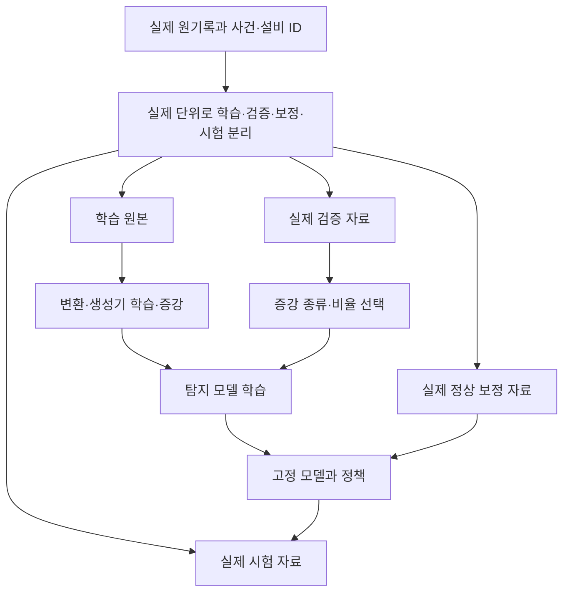

# 데이터 부족을 보완하는 증강·합성 데이터 계획

2026-10-01 · 사용자 추가 질문 반영 · [전체 계획](README.md) · [검증 계획](03_validation_and_execution_plan.md)

**증강은 현재 과제에서 충분히 검토할 가치가 있다.** 우선은 정상 신호의 제한된 변화를 학습시키는 방법, 구조를 유지한 잔차 재표본화, 명시적인 가상 이상 주입을 비교한다. GAN·VAE·확산 모델도 후보에 포함한다. 이 문서는 방법과 비교 설계이며 데이터를 생성하거나 모델을 실행하지 않았다.

## 1. 어떤 부족을 해결하려는가

| 부족한 것 | 증강으로 기대할 수 있는 도움 | 증강 뒤에도 남는 문제 |
|---|---|---|
| 학습 때 본 정상 변동의 폭 | 합리적인 작은 변동에 덜 민감한 특징 학습 | 실제 새로운 날짜·운전 조건을 확인한 것은 아님 |
| 이상 클래스의 학습 비중 | 반복·가중치·합성 표본으로 학습 기회 조절 | 독립 고장 사건의 종류와 수는 늘지 않음 |
| 약한 변화·여러 변화 형태 | 주입된 변화에 대한 민감도와 학습 목적 설계 | 합성 변화가 실제 마모/누설을 대표하는지는 별도 검증 |
| 짧은 기록·부분 관측 경험 | crop·mask로 부분 입력에 대한 학습 | 원래 기록되지 않은 신호가 관측값이 되지는 않음 |
| 계측 변화에 대한 대응 | 정의한 센서 교란의 반응 점검 | 교란과 실제 고장을 항상 구별할 수 있는 것은 아님 |
| 보정·평가용 독립 자료 | 직접 해결할 수 없음 | 생성 표본으로 신뢰구간·conformal 보정 표본 수를 부풀릴 수 없음 |

현재 600개 이상 행을 60,000개로 늘리는 것 자체는 쉽다. 연구의 질문은 **“같은 실제 평가 자료에서, 증강하지 않은 모델보다 좋아지는가?”**다. 표본 수를 늘렸다는 사실보다 어떤 일반화가 생겼는지를 확인한다.

## 2. 조사한 1차 문헌

| 자료 | 원출처와 확인 범위 | 우리 계획에서의 역할 |
|---|---|---|
| Iwana·Uchida, **An empirical survey of data augmentation for time series classification with neural networks** (2021) | [PLOS ONE 원문](https://journals.plos.org/plosone/article?id=10.1371/journal.pone.0254841), DOI `10.1371/journal.pone.0254841`; 방법·결과·제한 관련 절 확인 | 변환·혼합·생성·분해 계열의 지도. 증강 효과가 자료와 모델에 따라 달라진다는 근거 |
| Yoon·Jarrett·van der Schaar, **Time-series Generative Adversarial Networks** (2019) | [NeurIPS 원문](https://papers.neurips.cc/paper_files/paper/2019/file/c9efe5f26cd17ba6216bbe2a7d26d490-Paper.pdf); 생성 목적과 TSTR 평가 절 확인 | 시간·채널 관계를 고려한 GAN 후보, 실제 자료로 효용 평가 |
| Zhao 등, **T-SMOTE** (2022) | [IJCAI 공식 페이지](https://www.ijcai.org/proceedings/2022/334), [원문](https://www.ijcai.org/proceedings/2022/0334.pdf), DOI `10.24963/ijcai.2022/334`; 방법 절 확인 | 시계열 불균형 학습 후보. 단순 행별 SMOTE와 구분 |
| Desai 등, **TimeVAE** (2021) | [저자 arXiv](https://arxiv.org/abs/2111.08095); 초록·서지 확인, preprint로 취급 | 추세·주기 구조를 가진 비교적 작은 생성기 후보. 세부 구현 검수는 이후 |
| Yuan·Qiao, **Diffusion-TS: Interpretable Diffusion for General Time Series Generation** (2024) | [저자 공개 전문](https://arxiv.org/html/2403.01742v2), [서지](https://arxiv.org/abs/2403.01742); ICLR 2024 표기와 방법 개요 확인. OpenReview 직접 열람은 제한됨 | 다변량 시계열 확산 생성 후보. 프레스에서 우수하다는 근거는 아직 없음 |
| Tashiro 등, **CSDI** (2021) | [NeurIPS 공식 문헌](https://proceedings.neurips.cc/paper/2021/hash/cfe8504bda37b575c70ee1a8276f3486-Abstract.html); 초록·저자 코드 설명 확인 | 관측 조건부 결측 추정 연구. 원래 목적이 결측 복원이며 고장 생성의 검증된 근거로 쓰지 않음 |
| Shidani 등, **Beyond Real Data: Synthetic Data through the Lens of Regularization** (2026) | [AISTATS/PMLR 공식 페이지](https://proceedings.mlr.press/v300/shidani26a.html); 초록·서지 확인 | 합성 비율과 분포 차이의 상충관계 참고. 이미지 등에서의 결과를 프레스 최적 비율로 옮기지 않음 |

이 문헌들은 방법의 존재와 설계 논리를 뒷받침한다. 아래 구체적인 프레스 변환 범위와 실험 구성은 **우리 과제에 대한 제안**이며 문헌의 검증 결과가 아니다. 저자 코드·가중치를 실제 도입할 때는 해당 버전의 이용 조건도 별도로 확인한다.

## 3. 우선 비교할 방법

### 증강 0. 가중치·반복 학습을 먼저 대조군으로 둔다

지도 모델에서는 class weight와 동일 이상 기록의 단순 반복부터 비교한다. 새로운 파형 없이 학습 비중만 바꿔도 개선되면, 더 복잡한 생성기의 이익이 실제 다양성에서 온 것인지 다시 살펴야 한다.

부트스트랩이나 반복 샘플링은 학습 표본의 선택 방식이다. 독립 데이터가 늘었다고 해석하지 않는다. 정상 전용 모델에서는 소수 이상을 억지로 늘리는 것보다 정상 조건의 학습 가중치를 맞추는 편이 목적에 맞을 수 있다.

### 증강 1. 제한된 신호 변환

| 변환 | 가능한 활용 | 프레스에서의 제약·판정 |
|---|---|---|
| 동일 기록 내부 crop | 짧은 관측·시작 위치 변화에 대한 학습 | 원기록 ID 유지. 양성 파일의 모든 crop에 실제 고장 증상이 있다고 확정할 수 없음 |
| 작은 잡음 추가 | 확인된 계측 잡음에 대한 강건성 | 잡음 크기의 근거가 없으면 정상 라벨 보존을 단정하지 않고 민감도 시험으로 시작 |
| 제한된 공통 gain | 계측 이득·조건 변동 민감도 | 진폭 증가가 고장 단서일 수 있음. 물리적으로 허용되는 범위가 먼저 필요 |
| 채널별 offset/gain | 센서 변화의 스트레스 시험 | 독립 채널 관계를 바꾸므로 기본 정상 증강에서 제외 |
| mask·짧은 누락 | 일부 채널/관측 부족에 대한 학습 | 복원값은 관측값과 구분, 실시간에는 미래 값 사용 금지 |
| 시간 이동·phase 변화 | 주기 신호의 시작 위상 다양화 후보 | 관측 전류 패턴의 물리 원인이 불명. 채널 동기화와 경계 불연속 점검 |
| time warping | 속도 변화에 대한 연구 후보 | 표본화 차이와 물리 변화가 섞이므로 초기에 정상 증강으로 채택하지 않음 |
| 회전·채널 교환·순서 섞기·시간 반전 | 특정 연구의 후보 변환일 수 있음 | 상·하부 위치와 시간 의존성이 의미를 가지므로 현재 기본안에서 제외 |

초기 강도는 임의로 “±20%면 정상”처럼 정하지 않는다. 정상 **학습 부분**의 변동·계측 문서로 범위를 제안하고, 각 변환의 라벨 보존 근거를 기록한다. 이 근거가 없으면 정상으로 학습시키는 실험과 단순 스트레스 시험을 분리한다.

수치 저장 자릿수를 통일하는 것은 표현 통제다. 물리 값을 크게 바꾸는 재양자화까지 무해하다고 보지 않는다. 정상·이상 양쪽에 같은 처리 규칙을 적용하고 약한 신호 손실을 점검한다.

### 증강 2. 조건별 잔차를 구조를 유지하며 재표본화

가벼운 생성 대안으로 우선 검토한다. **정상 운전 구조를 설명하는 부분과 남은 다변량 잔차를 나누고, 같은 상태 안에서 잔차 묶음을 재조합**하는 방법이다.

제안 절차는 다음과 같다.

1. 정상 학습 기록 안에서만 전역 또는 조건별 평균/동역학 모델을 적합한다.
2. 세 채널의 잔차를 같은 시각의 벡터로 보관한다.
3. 상태·기록 길이가 맞는 범위에서 짧은 잔차 블록을 함께 재표본화한다. 채널을 각각 독립적으로 섞지 않는다.
4. 학습 정상 구조에 잔차를 더해 새로운 학습 입력을 만든다.
5. 경계의 불연속, 자기상관, 채널 공분산, 진폭 분포가 과도하게 달라진 샘플은 별도 표시한다.

블록 길이는 정상 학습 잔차의 상관 범위와 기록 길이를 보고 정한다. 50행 이하 기록에서 장기 열화나 긴 운전 사이클을 생성했다고 하지 않는다. 표본 수가 작은 상태는 생성 대상에서 빼거나 전역 모델로 축소한다.

이 방식도 새로운 물리 조건을 발견하지는 못한다. 다만 **어떤 구조를 보존하고 어떤 변동을 추가했는지 설명하기 쉬워**, GAN보다 먼저 비교할 가치가 있다. 합성 잔차가 원 데이터에서 없던 경계 스파이크를 만들면 해당 설계를 중단한다.

### 증강 3. 가상 이상 주입

정상 기록에 변화의 종류·강도·시작 시각을 정해 넣는다. 학습에 쓰는 경우 정상 전용 학습과 구별해 **합성 이상을 사용하는 학습**이라고 명시한다.

| 주입 형태 | 알아보려는 탐지 능력 | 라벨 의미 |
|---|---|---|
| 수준 jump·ramp | 순간/점진적인 평균 변화 | 합성 수준 변화 |
| 분산·진폭 증가 | 작거나 지속적인 신호 크기 변화 | 합성 산포 변화 |
| 짧은 충격·간헐 burst | 짧고 드문 변화 | 합성 충격 |
| 상·하부 관계 훼손 | 개별 크기는 비슷하지만 관계가 달라짐 | 합성 관계 변화 |
| 전류 파형의 일부 변형 | 기존 주기 구조 밖의 변화 | 합성 파형 변화 |
| 누락·상수화·포화 | 관측 품질 대응 | 합성 계측 교란, 설비 고장과 별도 |

베어링 마모·캐비테이션·누설 같은 실제 원인명을 이 표에 바로 붙이지 않는다. 그런 연결에는 물리 모델이나 해당 고장의 실측 자료가 필요하다.

같은 주입기를 학습·평가 양쪽에 써서 높은 점수를 얻는 것만으로 채택하지 않는다. 주입 종류 하나를 학습에서 빼는 평가, 강도가 다른 평가, 독립 실제 자료 평가를 나눈다. 검출 가능한 강도/지연의 곡선을 보고하고 가장 쉬운 큰 이상만 골라 제시하지 않는다.

### 증강 4. SMOTE 계열과 시계열 혼합

원시 시계열의 행을 일반 표 데이터처럼 보간하는 방식은 초기에 제외한다. 시계열 관계가 끊어지고, 위상이 다른 전류 파형을 평균내면 진폭이 상쇄될 수 있다.

대안은 같은 조건의 **기록 특징 공간**에서 제한적으로 보간하거나, 원시 파형을 쓸 경우 동기화·길이·라벨 의미를 맞춘 뒤 혼합하는 것이다. 두 부모 기록과 조건을 모두 추적한다. 정상과 이상을 섞어 생긴 중간 파형의 실제 고장 확률이 혼합계수와 같다고 가정하지 않는다.

T-SMOTE는 시간 구조를 고려하는 정식 연구 후보지만, 원문 방법은 앞선 부분 시퀀스와 분류 경계의 관계를 이용한다. 현재 프레스에는 고장 전 연속 이력이 없으므로 **논문의 early prediction 논리를 그대로 적용할 수 없다.** 사용할 수 있는 문제 정의가 맞는지 확인한 뒤 class weight·단순 반복과 비교한다.

### 증강 5. VAE·TimeGAN·확산 모델

생성 모델은 데이터 부족을 다루는 정당한 연구 방향이다. 현재 자료에서는 모델 규모보다 **무엇을 학습시킬지와 어디서 평가할지**가 먼저다.

| 생성 접근 | 제안 용도 | 필요한 선행 조건 | 중단 조건 |
|---|---|---|---|
| 작은 VAE / TimeVAE | 정상의 조건별 짧은 패턴 생성 | 정상 상태·길이 처리, 작은 구조로 시작 | 단순 잔차 생성보다 이익이 없음 |
| TimeGAN | 시간·채널 관계를 가진 정상 또는 클래스 조건 생성 | 학습 회차 분리, 모델 안정성, 원자료 암기 점검 | 같은 이상 기록을 거의 복제하거나 seed에 따라 붕괴 |
| Diffusion-TS | 조건부 다변량 패턴 생성 도전자 | 독립 회차가 있는 외부 자료에서 먼저 적합성 확인 | 불필요한 계산 비용, 실제 평가 성능 손실 |
| CSDI 계열 | 부분 관측의 복원/불확실성 연구 | 관측 마스크·추론 시점 정의 | 긴 공백을 실제 관측처럼 채워 결과를 만드는 경우 |
| 물리 시뮬레이션 결합 | 실제 조건을 바꾼 가상 운전/고장 | 펌프 기종·계측 변수·정상 물리 검증 | 프레스 변수에 없는 압력/유량을 임의로 가정 |

정상 전용 생성기를 먼저 고려하고, 실제 이상 600행만으로 범용 고장 생성기를 학습하는 안은 우선순위를 낮춘다. 이는 불가능 판정이 아니라 현재 독립 사건 다양성이 작다는 데 따른 선택이다.

외부 자료로 생성기를 학습한다면 단위·센서 표현·운전 조건을 맞춘 특징 수준 또는 표현 학습을 먼저 검토한다. 다른 펌프의 진동값을 그대로 프레스 CSV에 붙이지 않는다. 우리 프레스 이상을 평가하는 시험에서 해당 이상을 생성기 학습에 사용하면 누수다.

## 4. 가장 먼저 할 비교 실험 — 실행 지시 이후

처음에는 탐지 모델을 하나 고정해 **증강의 효과만** 비교한다. 그다음 최종 후보 두 모델에서 효과가 유지되는지 본다.

| 실험군 | 학습 자료 | 목적 |
|---|---|---|
| U0 | 실제 자료만 | 기준 |
| U1 | 실제 자료 + class weight/단순 반복 | 학습 비중 변화만으로 얻는 이익 |
| U2 | 실제 자료 + 라벨 보존 근거가 있는 제한 변환 | 작은 변동에 대한 일반화 |
| U3 | 실제 자료 + 상태별 다변량 잔차 재표본화 | 구조를 보존한 다양화 |
| U4 | 실제 정상 + 합성 이상 | 새로운 이상 형태에 대한 학습 효과 |
| U5 | 실제 자료 + 생성기 한 종류 | U2/U3 이상의 이익이 있는지 |

U1은 지도 모델 비교에만 해당하며 정상 전용 모델에는 맞는 가중치 대조군을 둔다. U5는 U2/U3의 품질·효용 검증을 마친 뒤 진행하는 조건부 단계다. 모든 생성기를 동시에 학습하는 계획은 아니다.

증강/실제 비율은 우선 0, 0.5, 1배를 비교하고, 이익이 유지될 때 2배를 검토한다. **이는 실험 설계용 제안값이며 입증된 최적 비율이 아니다.** 비율은 원기록 단위와 실제 배치 내 비중을 모두 기록한다. 증강량만큼 학습 step이 늘어 효과가 생기는 것을 구분하기 위해 동일 step 대조군도 둔다.

## 5. 누수를 막는 분할

- 생성기는 학습 부분만 본다. 전처리·조건 추정·주입 강도 선정도 같은 원칙을 따른다.
- 한 원기록에서 나온 crop·합성본은 원기록과 같은 그룹에 속한다. 두 부모를 섞었다면 두 부모 모두 학습 그룹이어야 한다.
- 보정셋에 합성 정상을 넣어 꼬리 표본 수를 늘리지 않는다. 원자료 120개를 12,000개로 생성해도 독립 보정 12,000개가 아니다.
- 주 시험은 실제 자료만 사용한다. 합성 시험은 별도 감도·스트레스 결과로 둔다.
- 현재 프레스 자료는 이미 본 자료이므로 이 설계를 새로 적용해도 탐색적 비교다. 검증 신뢰를 늘리려면 새 외부 회차/설비 또는 실제 추가 수집이 필요하다.

## 6. 생성 품질을 판정하는 방법

**보기에 그럴듯한 파형이나 t-SNE 그림만으로 합격시키지 않는다.** 다음을 함께 본다.

1. **기초 적합성:** 값 범위, 길이, 결측, 시간 간격, 단위, 물리적으로 금지된 값.
2. **시간 구조:** 자기상관·차분·주기/추세 특성. 짧은 10 Hz 기록의 주파수 해석은 관측 대역으로 제한한다.
3. **채널 관계:** 동일 시각 공분산, 시차 관계, 원 크기와 상대 관계의 동시 보존.
4. **암기와 다양성:** 가장 가까운 학습 원기록과의 거리, 반복 패턴, 조건별 생성 범위. 너무 가까운 복제와 근거 없는 범위 밖 신호를 구분한다.
5. **실제 효용:** 실제만 학습한 모델 대 실제+합성 모델을 같은 실제 시험 자료에서 비교한다. 합성만 학습·실제 평가(TSTR)는 보조 분석이다.
6. **민감도:** 생성 seed·증강 비율·조건별 결과. 실제 자료를 줄였을 때의 학습 곡선을 보되 같은 원기록의 많은 창으로 표본량을 부풀리지 않는다.

오경보 감소만 보고 채택하면 고장 신호를 정상으로 학습한 모델을 고를 수 있다. 약한 진폭 변화·지속 변화·전류 단독 변화에서 탐지 손실이 없는지도 같이 확인한다. 증가한 학습량·생성 시간·추가 의존성도 결과표에 넣는다.

## 7. 출처와 합성 자료의 기록 형식

합성 파일을 만들게 되면 다음 항목을 남긴다.

| 항목 | 내용 |
|---|---|
| 원자료 출처 | 기관/저자, DOI·URL, 버전, 실제 사용 파일 해시 |
| 생성 계보 | 부모 기록 ID 또는 생성기 학습 manifest, 학습 분할 ID |
| 생성 방법 | 변환식/알고리즘, 코드 버전, 파라미터, seed, 생성 시각 |
| 조건 | 알려진 실제 조건과 신호에서 추정한 조건을 구분 |
| 라벨 | 실측 라벨 / 라벨 보존 가정 / 합성 이상 종류 / 미확인 |
| 적용 범위 | 학습용, 검증용 합성 스트레스, 설명용 중 어디에 해당하는지 |
| 이용 조건 | 원자료와 코드·모델 조건, 제출/재배포 가능 범위 |

나중에 보고서에 포함한다면 “원데이터 ○개, 원기록 ○개, 합성 ○개”를 따로 적고 합성 자료임을 표·그림에 표시한다. 외부 기관이 생성한 실제 데이터처럼 보이게 쓰지 않는다. 원 논문 그림을 그대로 가져오는 대신 자체 실험 그림을 만들 경우에도 원자료·변환 방법·작성 주체를 함께 밝힌다.

## 8. 잠정 권고와 다음 판단

현재의 첫 비교 순서는 **무증강·가중치 대조 → 제한된 정상 변환 → 다변량 잔차 재표본화 → 합성 이상 학습 → 생성 모델 한 종류**다. 생성 모델이 핵심 아이디어가 될 가능성은 열어두되, 간단한 증강보다 좋은 실제 효용을 먼저 요구한다.

증강을 주력 차별화로 선택하려면 “몇 배 늘렸다”가 아니라 **어떤 정상 변화를 더 잘 허용하고, 어떤 약한 이상을 추가로 잡으며, 실제 시험에서 이익이 유지되는지**를 보여야 한다. 이 질문을 만족하지 못하면 증강은 학습 보조 또는 검증 도구로 남긴다.
