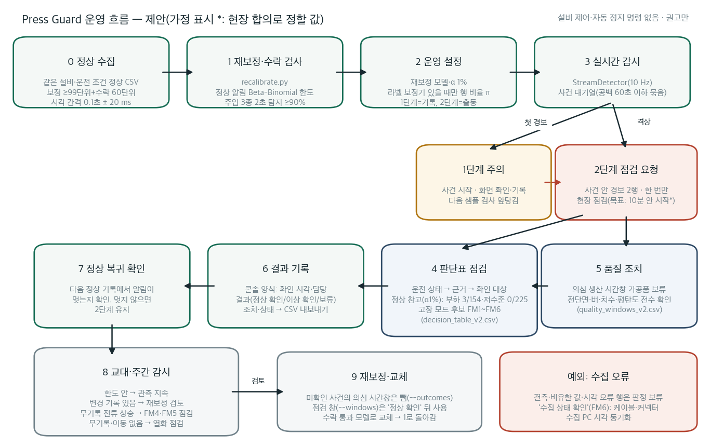
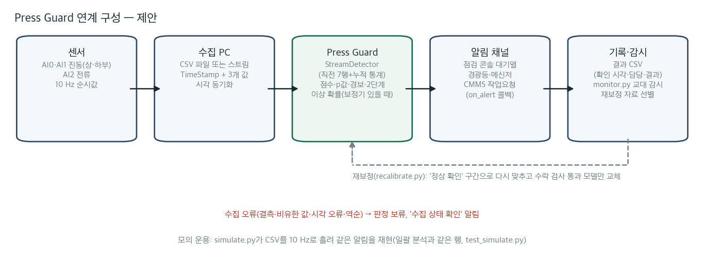

# Press Guard 운영 절차 — 제안

유압 프레스 1대(진동 센서 2개·전류 센서 1개, 10 Hz 수집)에서 Press Guard를 운영하는 절차다. 설비 제어나 자동 정지 명령은 보내지 않고, 사람에게 권고만 한다. 표시 규칙은 다음과 같다.

- **[가정]:** 현장과 합의해 정할 값이다. 대회 자료로 검증하지 않았다.
- **[근거]:** 이 저장소의 산출물 파일이다.

## 1. 절차

| 단계 | 담당[가정] | 할 일 | 명령·파일 | 목표 시간[가정] |
|---|---|---|---|---|
| 0 정상 수집 | 보전 | 같은 설비·운전 조건에서 정상 운전 CSV를 모은다. α=1%면 형식상 최소 174단위(학습 15·보정 99·수락 검사 60)로, 대회 수집 밀도(경과 1시간에 약 447단위)에서 약 23분이다. 이 최소량은 conformal 계산과 보완 실험 E3의 사후 곡선에서 나온 값이라 권장량이 아니다. 기본값과 대회 재보정 시험(학습 300·보정 120·수락 60)은 480단위, 경과 약 61분이다. 수집 시각 간격은 0.1초 ± 20 ms 안이어야 한다(밖이면 기록이 쪼개진다. 평균 기록 길이가 5행 미만이면 모든 명령이 경고한다) | CSV 열: `TimeStamp, AI0_Vibration, AI1_Vibration, AI2_Current` | 설치 전 |
| 1 재보정·수락 검사 | 보전 | 학습·보정 후 수락 검사를 한다. (a) 정상 알림 단위 수가 보정 조건부 Beta-Binomial 95백분위 이하인가. (b) 주입 고장 3종의 2초 안 탐지율이 90% 이상인가. 통과할 때만 모델을 저장한다 | `python recalibrate.py --normal 정상.csv --out site.json --target-alerts-per-8h 3` → `site_report.json` | 1회 |
| 2 운영 설정 | 보전·품질 | 모델과 α=1%(기본)를 정한다. 대회 모델에 라벨 확률 보정기가 있으면 π는 이상 **행 비율** 가정(기본 1%)이고 기록 확률은 같은 π를 쓰는 근사다. 정상 자료만으로 만든 재보정 모델에는 라벨 보정기가 없어 확률·우도비 열 4개가 비고 π는 쓰이지 않는다. 이 경우 라벨 없는 알림 단위 환산만 참고한다(아래 설명). 1단계는 화면 기록, 출동은 2단계로 한정한다 | `serve.py`(대회 모델 콘솔), `simulate.py --model site.json`(재보정 모델 모의 운용) | — |
| 3 실시간 감시 | 작업자 | 우선순위순 사건 대기열과 운전 상태(부하·저수준·판정 대기)를 본다. 경보가 이어진 알림 단위(사이 공백 60초 이하)는 한 사건이고, 사건마다 1단계 "주의"(화면 확인·기록)와 누적 경보 2행의 2단계 "점검 요청"(현장 점검)을 한 번씩 받는다 | 콘솔 점검 워크스페이스, `simulate.py` | 2단계 알림 뒤 10분 안에 확인 시작 |
| 4 판단표 점검 | 작업자·보전 | 운전 상태 → 경보 근거 → 확인 대상 → 점검 항목·고장 모드 후보(FM1~FM6) 순으로 확인한다. 대회 정상 평가 참고율(보정값이 다른 적합 5개 합침, α1%)은 부하 3/154·저수준 0/225·17행 미만 0/101이다. 첫 경보는 대개 기록 17행 전이라 상태가 판정 대기다. 그때는 참고율을 쓰지 않고 17행째(1.6초 뒤)나 다음 기록에서 상태를 확인한다. 같은 날 사후 분석이며 현장의 조건별 오경보 보장은 아니다 | [decision_table_v2.csv](outputs/decision_table_v2.csv), [failure_mode_map.csv](../analysis/press_evidence/failure_mode_map.csv), [normal_alarms_by_state.csv](../analysis/press_evidence/normal_alarms_by_state.csv) | 교대 안 |
| 5 품질 조치 | 품질 | 2단계면 의심 생산 시간창의 가공품을 보류하고 전단면·버·치수·평탄도를 전수 확인한다. 1단계면 다음 샘플 검사를 앞당긴다 | 대기열의 `suspect_from/to`, [quality_windows_v2.csv](outputs/quality_windows_v2.csv) | 교대 안 |
| 6 결과 기록 | 담당자 | 콘솔 양식에 사건마다 확인 시각·담당·결과(정상 확인·이상 확인·보류)·조치를 적는다. 정상 확인이나 이상 확인이면 사건이 닫히고 보류면 열린 채로 남는다. CSV로 내보낸다 | 콘솔 "점검 결과 기록" → 사건 CSV | 사건마다 |
| 7 정상 복귀 확인 | 작업자 | 조치 뒤 다음 기록에서 알림이 멎는지 본다. 멎지 않으면 2단계를 유지한다 | 콘솔 대기열 | 조치 직후 |
| 8 교대·주간 감시 | 보전 | 감시 창별 알림 단위 수를 Beta-Binomial 95·99백분위와 비교한다. 99백분위 초과 또는 연속 2창의 95백분위 초과·전류 상승 이동이면 조치한다. 조치 대상이 아니면 "관측 지속", 변경 기록(금형·가압력·생산품)이 있으면 "재보정 검토(운전 조건 변경)", 변경 기록 없이 전류 수준이 상승 이동하면 "설비 점검 요청(전류 수준 이동: FM4·FM5 점검, 정상 확인이면 재보정)", 이동도 없으면 "설비 점검 요청(열화 의심)"이다. 관측 지속이 아닌 창(재보정 검토·두 점검 분기)은 결과가 정상 확인일 때만 재보정 자료로 쓴다. 변경 기록은 정상 확인을 대신하지 않는다. 창별 시작·격상 알림 수는 사건 단위다 | `python monitor.py --csv 교대.csv --split B --changes 변경기록.csv --out 창별.csv`, [monitor_gain_v2.csv](outputs/monitor_gain_v2.csv) | 교대 끝 |
| 9 재보정·교체 | 보전 | "재보정 검토"이거나 설비 점검 결과가 정상 확인이면 1단계부터 다시 한다. 정상 확인으로 닫히지 않은 사건의 의심 시간창은 `--outcomes`로 뺀다. 감시 창 CSV에 `outcome` 열(정상 확인·이상 확인·보류)을 기록해 `--windows`에 넣으면 조치 대상 창("재보정 검토"와 두 종류의 "설비 점검 요청")은 결과가 "정상 확인"일 때만 남는다. 변경 기록은 조치의 종류를 가를 뿐 정상 확인을 대신하지 않는다. 빈 결과·열 없음은 미확인으로 보고 그 기간을 뺀다. 수락 검사를 통과한 모델로만 교체한다 | `python recalibrate.py --normal 정상.csv --outcomes 결과.csv --windows 창별.csv --out site2.json` | 검토 뒤 1주 안 |

**예외: 수집 오류.** 결측·비유한 값·시각 오류·역순 행은 판정하지 않고 "수집 상태 확인"을 권한다. 확인 대상은 센서 케이블·커넥터와 수집 PC 시각 동기화다(FM6).

수집 시각 순서는 마지막으로 받아들인 시각(기준)과 비교한다. 같거나 늦은 시각은 받아들인다. 미래 시각 한 행이 튀고 다음 행이 원래 시간축을 이으면 튄 행만 건너뛰고 판정을 계속한다. 기준보다 이른 행(순서 뒤바뀜·시계 재설정·지난 자료)은 `bad_time_order`로 판정을 보류한다. 그런 행이 0.1초 ± 20 ms 간격으로 3행 이어지면 셋째 행부터 새 기준으로 받아들이고 새 기록으로 판정한다(보류 2행). 간격이 불규칙하면 계속 보류한다. 보류 행 수와 새 기준을 받아들인 곳 수는 경고로 남는다. 미래 행을 보고 정렬하거나 과거 경보를 고치지 않는다. 동률·중복 시각은 기존처럼 기록 경계로 처리한다. 오류 행은 정상 복귀 근거가 아니다. 사건을 닫거나 나누지 않고, 품질 의심 시간창의 끝도 정하지 않는다. 오류·경계로 생긴 8행 미만의 무경보 조각도 사건을 닫지 않는다.

운전 상태는 원 전류의 기록 안 누적 평균 제거 RMS(ddof 0)가 91.9 이상이면 부하, 미만이면 저수준이다. 17행 미만은 판정 대기로 둔다. 사후 진단용 참고이며 경보 규칙을 바꾸지 않는다. 콘솔은 첫 경보 시점의 상태와 건 끝 상태를 구별한다.

라벨 보정기가 없는 모델의 라벨 없는 환산은 알림 단위 이상 비율과 가정 탐지율·정상 알림률을 써서 알림 한 건을 해석한다([label_free_alert_probability_v2.csv](outputs/label_free_alert_probability_v2.csv)). 최소 순위 문턱의 명목 정상 알림률은 1/(n+1)이고 일반 α에서는 ⌊α(n+1)⌋/(n+1)이다. 실제 고장 탐지율과 현장 기저율을 몰라 절대 확률로 검증된 값은 아니다.

콘솔의 "모형 상한"은 행 우도비를 n+1에서 자르는 표시 정책이다. 행 우도비의 이론상 상한이나 실제 고장 확률의 하한을 뜻하지 않는다.

## 2. 알림 예산과 두 단계

| 항목 | 값 | 근거 |
|---|---|---|
| 1단계(주의) 교대 8시간 | 명목 약 30건. 대회 B 관측 60건, 이항 95% 상한 152건, 보정 표본 흔들림을 반영한 사후 95% A 44·B 92건(같은 날·교환가능성 가정) | [alert_levels_v2.csv](outputs/alert_levels_v2.csv), [workload_v2.csv](outputs/workload_v2.csv) |
| 2단계(점검 요청) 교대 8시간 | 비중첩 폴드 주추정 4.2건(95% 상한 15.4건): 1단계 명목 × 규칙 선택 자료와 겹치지 않는 시간순 폴드(300~359·360~419) α 5%의 2단계/1단계 비 1/7. 규칙 자체는 사후이고 같은 날 추정이다. 기존 1/9 → 3.3건(상한 12.7건)은 폴드 540~599가 B 평가(420~599)와 겹쳐 민감도 비교로 둔다(기록 570은 규칙 선택에 본 오경보). 동결 B α3% 2/5 → 11.8건, α5% 3/7 → 12.7건도 민감도 비교다. 주추정은 2단계 1건에 기댄 비라 불확실성이 크다. 95% 상한은 비의 이항 상한만 반영하고 1단계 알림 수의 불확실성과 분할에 따른 차이는 넣지 않았다. 대회 정상 평가 0건(A 0/120·B 0/180, 95% 상한 88·59건)은 규칙 선택에 사용한 표본 안 값이다 | [expected_effect_v2.csv](outputs/expected_effect_v2.csv), [alert_levels_v2.csv](outputs/alert_levels_v2.csv) |
| 이상 21구간 | 사건 1개, 알림 2건(1단계·2단계). 첫 경보 뒤 0.1~0.2초에 격상했다. 구간 단위로 셌다면 알림 42건이다 | [incident_summary_v2.csv](outputs/incident_summary_v2.csv)(사후 관찰) |
| 주입 고장(E1식) 2초 안 탐지(α 1%) | 전류 잡음 0.1σ 1단계 97% → 2단계 90~93%, 진동 잡음 2σ 77~95% → 38~79% | [alert_levels_injection_v2.csv](outputs/alert_levels_injection_v2.csv) |
| 목표 k건/교대 설계 | 3건이면 α≈0.08%, 보정 약 1,200단위(정상 약 2.7시간). 현재 구현의 α 선택지(1·3·5%)로는 이 설계를 실행할 수 없다. 그 전까지는 1단계 기록·2단계 출동으로 예산을 맞춘다 | [alert_budget_design_v2.csv](outputs/alert_budget_design_v2.csv), `recalibrate.py --target-alerts-per-8h` |

2단계 규칙(사건 안 경보 2행)은 사후에 정했다. 대회 B 오경보 3건이 모두 경보 1행이라는 관찰을 본 뒤다. 약한 진동형 고장은 1단계에만 남을 수 있다. 그래서 1단계도 화면에 기록하고 품질 샘플 검사를 앞당긴다.

## 3. 구성

- 알림 전달(경광등·메신저·CMMS 작업 요청)은 `simulate.run(on_alert=...)` 콜백이나 콘솔 대기열에 붙인다.
- `simulate.py`는 CSV를 10 Hz로 흘려 사건 알림(시작·격상)을 낸다. 알림 행과 단계는 일괄 분석과 같다(`test_simulate.py`).
- 콘솔 화면: [작업 화면](outputs/console/console_workspace_v2.png), [성능 검증 화면](outputs/console/console_evidence_v2.png). 캡처 도구는 `tools/capture_console.py`다.

## 4. 기대효과를 읽는 법

[expected_effect_v2.csv](outputs/expected_effect_v2.csv)는 가정 기반 시나리오다.

- **출처 있는 값:** 가동 중단 2~3일(가이드북 7쪽).
- **가정한 값:** 점검 시간, 고장 빈도, 줄이는 비율. 모두 범위로 둔다.
- **손익분기 배수:** "가동 중단 1시간 손실이 점검 인력 1시간 비용의 몇 배를 넘어야 이득인가"다. 절감액은 주장하지 않는다.
- **운영 방식:** "2단계만 출동"은 비중첩 폴드 주추정(교대 4.2건, 95% 상한 15.4건)과 민감도 행을 함께 읽는다. "관측·2단계만 출동" 행의 점검 0시간은 사후 규칙의 표본 내 값이라 결론으로 쓰지 않는다(`post_hoc` 열). 현장 첫 주의 실측으로 예산을 다시 잡는다.
